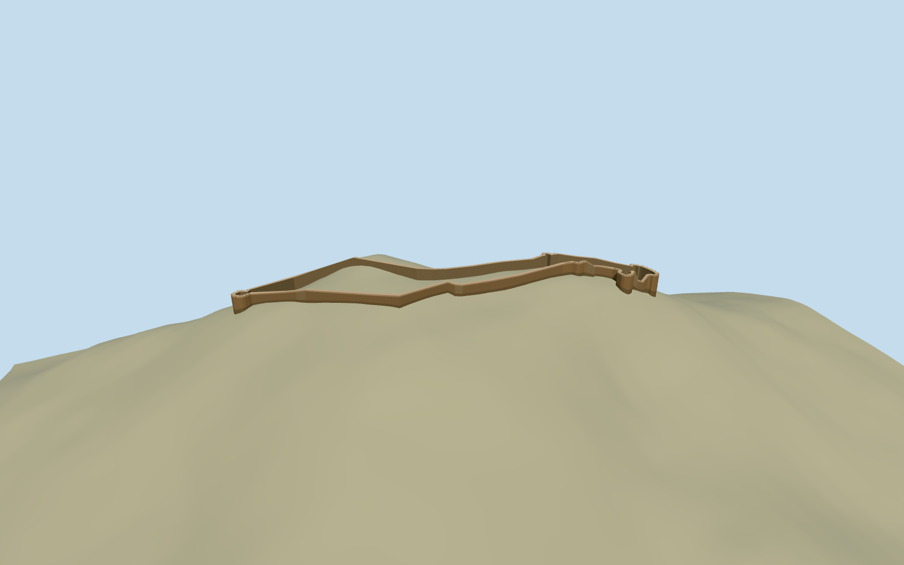

# Hari Parbat Fort

The historic stone fortress along the summit of Hari Parbat, with terraced curtain walls and rounded bastions in their mapped positions.

Authoring state: **review-in-qa.json**. Current completion evidence is in [qa.json](qa.json) and the [completion ledger](../../../../qualla-structures/batches/qualla-003.PROGRESS.md).

- [Hari Parbat Fort](https://qualla.com/hari-parbat-fort/)

Coping widths, thicknesses, tower crown heights, and mortar details are estimated from the mapped wall shape and the historic silhouette. The open outline of the hilltop remains visible.

The recipe depicts the documented exterior masonry. The city wall below and separately mapped historic temples and gateways are outside the model.

Build: `node content/worldgen/source/places/tw/twj/hari_parbat_fort/models/generate-hari-parbat-fort.mjs`. Add `--check` to verify exact regeneration. 2870 triangles; 4 materials; no embedded photographs.
