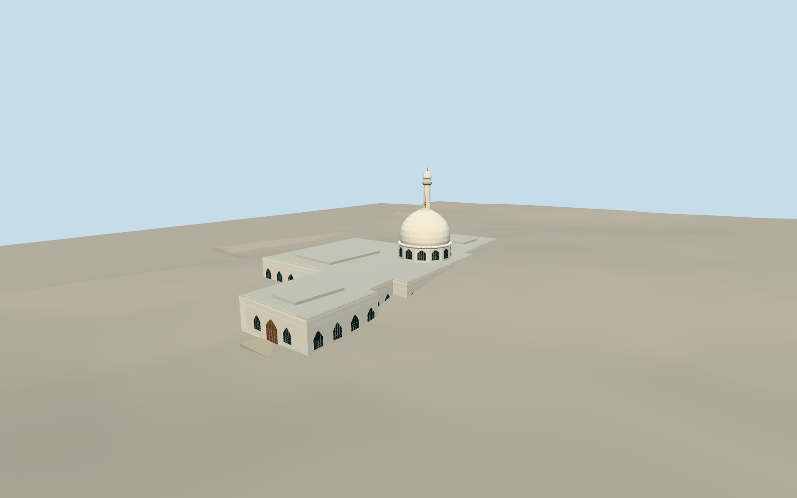

# Hazratbal Shrine

White marble lakeside shrine with a separately mapped round dome above its windowed drum, one balcony minaret, pointed arched windows, pale roof terraces and a gilded finial.

Authoring state: **review-in-qa.json**. Current completion evidence is in [qa.json](qa.json) and the [completion ledger](../../../../qualla-structures/batches/qualla-003.PROGRESS.md).

- [Hazratbal Shrine](https://qualla.com/hazratbal-shrine/)

The native building outline and traced dome fix plan and scale. Minaret position, building height, service wing roofs and hidden façades are estimates from the public-domain views and map.

Shared stone and metal materials approximate marble joints, gilding, lattice and carved bands. The roof terraces and window divisions use reconstructed proportions.

The original elevation tile represents the present shore and stays unchanged. Exact vertical contact and ground below the terraces are approximate at available DEM resolution.

Build: `node content/worldgen/source/places/tw/twj/hazratbal_shrine/models/generate-hazratbal-shrine.mjs`. Add `--check` to verify exact regeneration. 9312 triangles; 6 materials; no embedded photographs.
