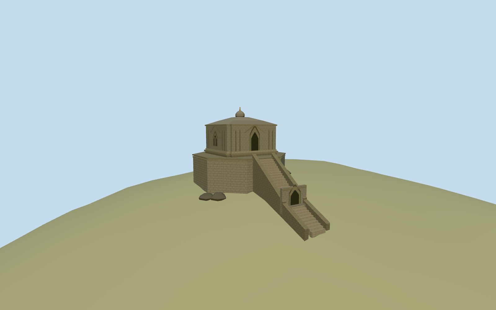

# Shankaracharya Temple

Kashmiri stone shrine on a tall octagonal terrace above Srinagar, reached by an axial stair and narrow gateway.

Authoring state: **review-in-qa.json**. Current completion evidence is in [qa.json](qa.json) and the [completion ledger](../../../../qualla-structures/batches/qualla-003.PROGRESS.md).

- [Shankaracharya Temple](https://qualla.com/shankaracharya-temple/)

Main geometry uses the historic survey, native roof location, documented stone podium and original summit relief. Exact modern openings, wall details and connecting steps are approximate.

Cole’s elevation labels restoration. The model uses the observed lower roof silhouette in Burke’s photograph with the plan and measured dimensions, including estimates for the upper stone and finial.

Only the shrine, octagonal platform and immediate axial stair are modeled. Later service buildings, long uphill steps and proposed ropeway works are outside the shrine scope.

Build: `node content/worldgen/source/places/tw/twj/shankaracharya_temple/models/generate-shankaracharya-temple.mjs`. Add `--check` to verify exact regeneration. 3511 triangles; 6 materials; no embedded photographs.
