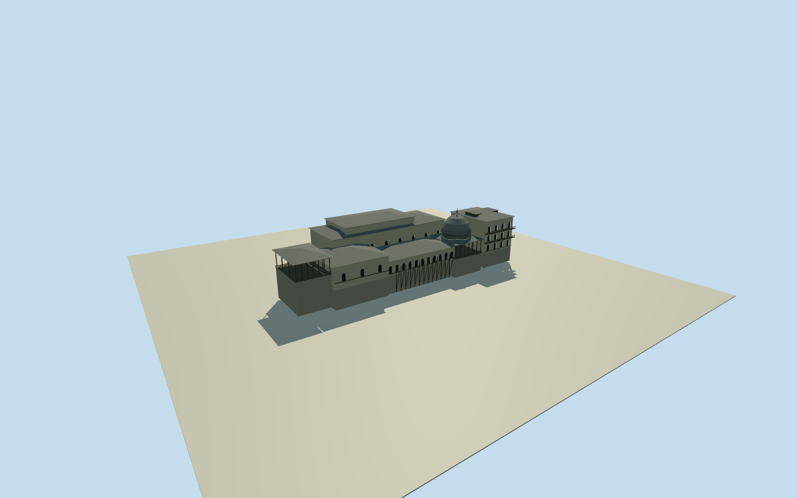

# Sher Garhi Palace — historic riverfront

Historic Sher Garhi riverfront palace: projecting multistorey arched north bay and balconies, open domed pavilion/finial, long arched gallery/stone river revetment/timber supports, square south pavilion, terminal open veranda and stepped high rear hall with layered hip roofs. PrimaryGettyCC0Burke/Baker photograph1860s–1870s. Rear massing,107m riverfront/35mdepth and sections original visual estimates; no measured wholecompound or present-day palace claim.

Authoring state: **review-in-qa.json**. Current completion evidence is in [qa.json](qa.json) and the [completion ledger](../../../../qualla-structures/batches/qualla-002.PROGRESS.md).

- [Sher Garhi Palace](https://qualla.com/sher-garhi-palace/)

Photograph-based original medium-fi reconstruction of the complete visible historic riverfront palace assembly, with explicitly estimated depth/rear closures. PrimaryGetty6633x5088CC0original1860s–1870s. Nativecurrentpropertyisnotwalls andmodernbuildingcontrolsnotclaimedhistoric. Approximate107mriverfront by35mdepth; one scale and signed axes, no independent measured building plan.

Original independent129x129/256mproviderfield acquired before floor/sections/geometry. Fixed visualization datum0 at landside[0,12]. Riverrevetmentbase-2.6m;galleryfloor6.2m/eaves11.7m;palacebayeaves20.7m;domecap24.3m/finial26.8m;raisedrearhallridge24.9m. Approximatephotographicproportions, not surveyedhistoricriverlevel/floors/contact; do notfitfield/floorsaftergeometry.

The nominal1870reviewdate lies inside the museum1860s–1870srange, not an exact acquisitiondate. Historicalplacementavailability restricted1860-01-01..1880-01-01 solely as an explicitlyapproximate interpretiveperiod.

Unseenreardepth/materialcolors/windowcensus/stonecoursing/finialshape/structuralframing estimated; no currentpalace or completegovernmentcompound claim.

OriginalcontemporaryDEMmaycontainbuilding/canopyorbankartifacts; historicalriverlevel/contactunverified. Naturalriver/trees/boat/people andmount/stampnotgeometry.

Build: `node content/worldgen/source/places/tw/twj/sher_garhi_palace/models/generate-sher-garhi.mjs`. Add `--check` to verify exact regeneration. 5518 triangles; 5 materials; no embedded photographs.
