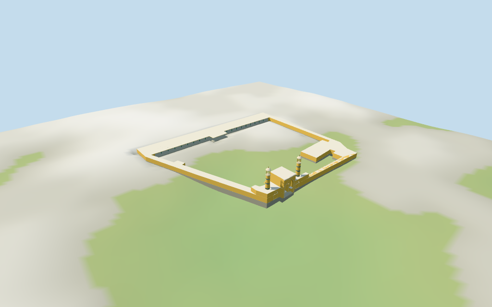

# N0479 — Id Kah Mosque

Reviewed 2026-10-18 for its declared medium-fi exterior and approximate geographic fit. Heights, internal layout and roof partitions are estimates.

## Exterior and shared materials

Inspected 11 current portable views, including the retained 1024×640 summary. The irregular low ring and open courtyard, yellow portal and wings, white pointed blind-arch trim, deep pointed recess and clear rectangular passage, paired tapered minarets with blue bands and open capped lanterns, and west veranda with green columns and white beams/brackets are present. Removed the low roof strip that crossed the passage and removed a duplicate yellow ceiling reveal over the veranda plaster. Fine historic decoration and inscriptions are abstracted; garden, trees, street furniture, carpets, furnished interiors and adjacent buildings are excluded.

Inspected 11 current shared-material/geographic-flat views, including the placement overlay. Seven existing 256² graphs provide yellow glazed brick, pale raw/coursed limestone, lime plaster, green timber, blue ceramic and cast bronze. Seven merged roles use metric UVs and linear tints, with no embedded images or unique atlas. Graphs are read once and model geometry is disposed on eviction. Precise building subtraction preserves all 60 nearby buildings, including a southern building sharing boundary vertices with zero area overlap; the coarse occupancy raster would incorrectly claim that neighbor, so its fallback is disabled by the explicit cutout. Two exact notched terrain masks retain the courtyard ground. Corrected final views show land in the courtyard, and unload restores the terrain opening state.

## Browser levels

| Level | Triangles | Bytes | Draws |
| --- | ---: | ---: | ---: |
| skyline | 918 | 85740 | 1 |
| district | 2385 | 201092 | 7 |
| street | 7781 | 720032 | 7 |
| closeup | 9429 | 859492 | 7 |

**286,832 bytes for initial skyline plus district**, plus seven existing shared 256² graphs. Seven merged roles; no embedded images.

Inspected 27 current medium-fi views: Economy/High, noon/late light, street/block/skyline, silhouette, six details, four matched LODs and four transitions. The low irregular compound, open courtyard, yellow gate, twin tower silhouettes and sheltered green colonnade remain visible. Skyline retains 11 coarse columns, a clear gate and four-post open lanterns; district restores 21 columns, blind niches and three blue bands; street restores 42 columns, joists, finer lanterns and original coarse band diamonds; closeup adds brackets and backing panels. Street overview cameras favor the courtyard and crop the gateway; dedicated details cover the gate and veranda. Context houses are synthetic. Physical laptop/phone/tablet and full-city timings remain unmeasured.

## Placement and limits

Retained Q1325825 reference anchor is unchanged. Current PMTiles has one named Id Kah Mosque point inside a single large courtyard building,52776572429281,with13 outer and27 inner vertices. The building has no exact Wikidata tag;selection is a reviewed approximate association from the named point,location and compound shape. The west outer edge supplies an undirected alignment;the eastern projecting gate and inspected gateway picture supply approximate facing. The courtyard hole stays open. No measured facade,roof partition or signed survey bearing is claimed. Standard Protomaps20261014 and Mapzen/USGS viewer extractN0479;datum 1300.191498056187 m. The floor is the median of 344 outer/court edge samples plus0.25 m. 1103 mapped-ring samples range -2.956909692738691 to 2.7874161669869864 m. Footings follow sampled grade;the exact court hole remains open in the replacement mask. The synthetic fixture seats only the mapped ring and a3 m margin to avoid raster interpolation at walls. Exact steps,thresholds,drains and finished ground levels remain approximate. Independently reproduced 13 outer and 27 courtyard vertices, the named point, the mapped4 m height and the west-edge alignment0.29271244284415965 rad. The selected building has no exact Wikidata identity tag; the source records a reviewed approximate association. Two simple notched polygons partition the exact mapped ring for ground cutting. Separate precise building subtraction leaves all60 neighbors unchanged. All366 placement/host-area checks and1,561 FrontSide probes pass for the open entrance/head, closed blind niches, open courtyard, green stems, plaster ceiling, tower tips, open lanterns and both outer/court foundations. Standard DEM reproduces1,103 ring samples,344 edge samples and549 seated fixture points and the16-bit heightmap. Preview terrain seating and contact remain approximate.

Individual Id Kah Mosque compound: retained irregular ring and open courtyard,yellow entrance portal and wings with white pointed blind-arch trim,a real central passage,two tapered minarets with blue geometric bands and open capped lanterns,low pale roof ranges and a sheltered west prayer-hall veranda with green timber columns,white beams and coarse brackets. Garden,trees,street furniture,adjacent buildings,inscriptions,carpets,furnished interiors and engineering are excluded. The mapped whole-building height4 m controls the low courtyard ranges. Estimated levels above the local floor: prayer-hall roof4 m,veranda ceiling3.8 m,front wings7.2 m,portal13.8 m and two minarets22.6 m including finials. Gate dimensions,blind niches,tower positions/profiles,columns,brackets and roof details are visual estimates. No retained dimensional facts or individual part height tags exist. The reference anchor, named map point and compound shape support approximate placement. Building identity is not an exact Wikidata-tag match. The two inspected2011/2007 pictures establish gateway and hall vocabulary, not a measured full facade or complete current condition. Portal and minaret dimensions/positions, blind-niche counts, internal layout, veranda rows, roof construction, vertical datum, precise steps and thresholds remain estimates. The whole mapped4 m height supplies the low ranges only; the taller gateway/towers are explicitly estimated. Garden, furnishings, inscriptions, historic artwork and engineering are unverified or omitted.

## Verification

49 current views inspected; 1,561 FrontSide probes; 366 placement/host-area checks; six zero-error/zero-warning Khronos validations. Model/source/input/material/capture/placement hashes agree. Raw map component controls and 16-bit terrain fixture reproduce. Source/placement checks, scene validate/sim30, selected LOD layout and Biome pass. Bulk captures stay ignored.

Source: sha256:646d9e506bb13b677f3f5325ef44eaf53ac31af0d3c0764d2dc042e12808dbfd

Runtime: sha256:b0f849cf38e12915fb0845f6cb8e21c689280c91eaabbbe5bfa5fa14b92b1702

Input: sha256:b2d95dfcbcc227c837cfd7e81ec2134d3376683f7e6b14d9ae854cc97d58089d

Commands: targeted generate-additional-landmarks/import-next-1000-models/generate-landmark-lods/register-landmark-previews --ids=N0479; source/placement --check; capture-next-1000-models --reflections --antialias --fit-shadows; capture-landmark-library --reflections --adaptive-clipping --bounded-placement; capture-medium-fi --ids=n0479_id_kah_mosque --reflections; scene validate/sim30; selected LOD layout; Biome. Existing builds reused.

## Inspected picture references

[Elyasaf Freiman — 2011-04-21](https://commons.wikimedia.org/wiki/File:IdKahMosque.JPG). Public domain. Inspected800×600 gateway view:yellow masonry,white outlined pointed blind niches,a deep pointed central recess over a rectangular passage,projecting toothed coping and a tapered minaret with blue/cream bands and an open capped lantern. The cropped view does not establish a measured whole facade;second tower and plan positions remain estimates supported by the gate composition.

[G41rn8 — 2007](https://commons.wikimedia.org/wiki/File:Kashgar_May_2007_467.jpg). CC-BY-SA-4.0. Inspected960×720 hall view:slender green timber columns with molded bases,white transverse beams and small curved brackets beneath a flat white ceiling. The model abstracts this vocabulary for the sheltered courtyard veranda;carpets,lamps,fans and furnished interiors are omitted.
