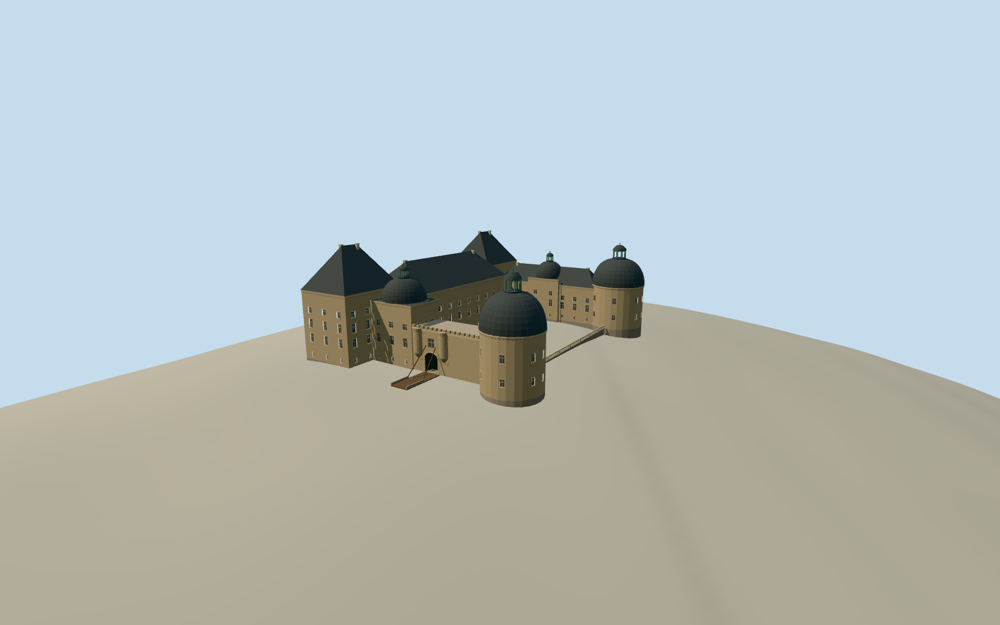

# Château de Hautefort

The limestone Château de Hautefort with its steep slate pavilions, domed round towers, copper lanterns, drawbridge gate and open court.

Authoring state: **review-in-qa.json**. Current completion evidence is in [qa.json](qa.json) and the [completion ledger](../../../../qualla-structures/batches/qualla-003.PROGRESS.md).

- [Chateau de Hautefort](https://qualla.com/chateau-de-hautefort/)

The model depicts the main château in August 2013, including the limestone residence, two connected wings, circular tower roofs, drawbridge entrance and open court.

The cadastre-derived outline and bridge locate the major volumes. The cleared 2013 exterior and detail views determine the entrance frontage, roof silhouette, lantern and balustrade. Exact roof slopes, far-side opening counts and relative heights are reconstructed estimates.

The original Terrarium hillside is preserved. The bridge and court use approximate terrace levels.

Build: `node content/worldgen/source/places/u0/u00/chateau_de_hautefort/models/generate-hautefort-chateau.mjs`. Add `--check` to verify exact regeneration. 35293 triangles; 6 materials; no embedded photographs.
