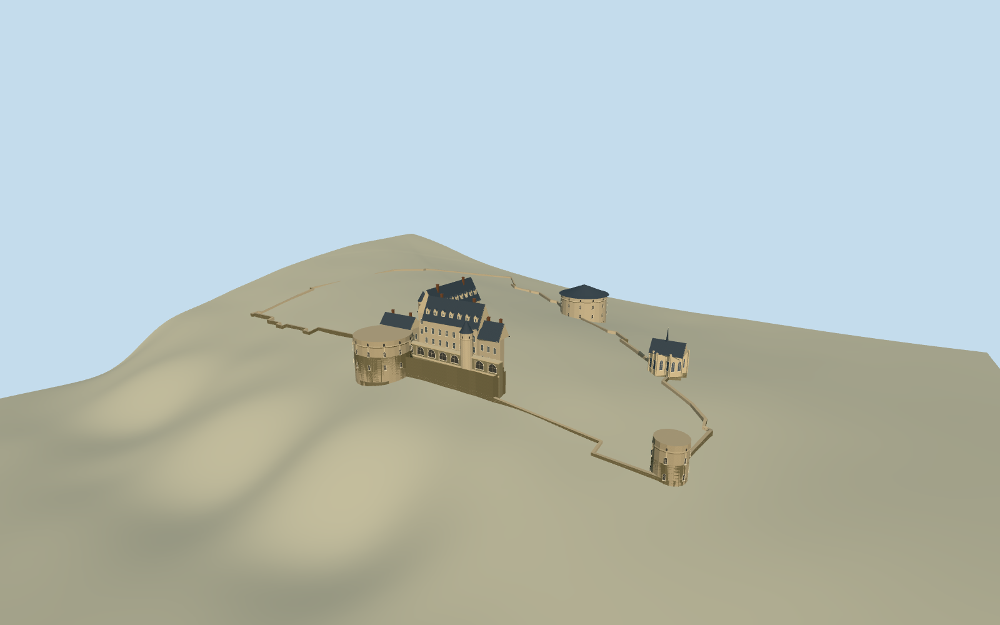

# Château d'Amboise

The royal lodging, vaulted river facade, Tour des Minimes, Tour Heurtault, Tour Garçonnet and Chapelle Saint-Hubert above the Loire.

Authoring state: **review-in-qa.json**. Current completion evidence is in [qa.json](qa.json) and the [completion ledger](../../../../qualla-structures/batches/qualla-004.PROGRESS.md).

- [Chateau d'Amboise](https://qualla.com/chateau-d-amboise/)

Roof and chapel heights use the scale of the documented surviving wings. Terrace masonry, fine sculpture and less visible roof details are simplified. The original DEM preserves the bluff and terrace but averages narrow vertical edges.

Build: `node content/worldgen/source/places/u0/u02/chateau_d_amboise/models/generate-chateau-d-amboise.mjs`. Add `--check` to verify exact regeneration. 20323 triangles; 6 materials; no embedded photographs.
