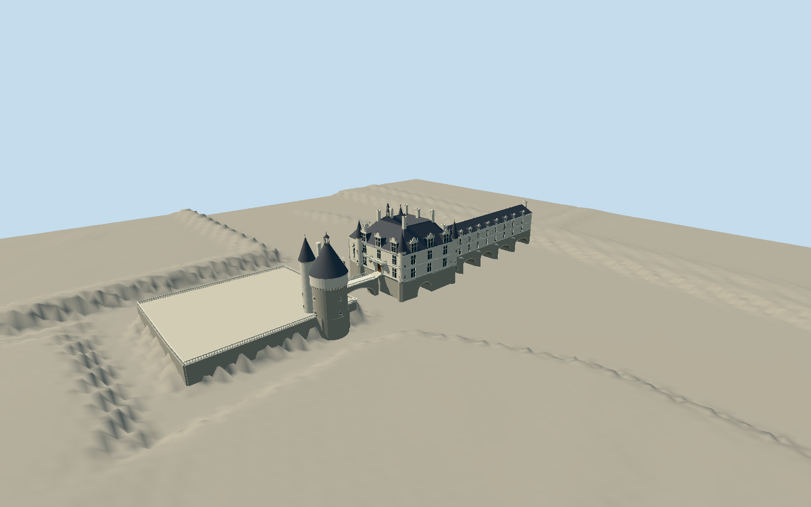

# Château de Chenonceau

River château with five actual gallery arch voids, independent old-mill boat passage, pointed chapel glazing and polygonal study. Nine gallery windows/oculus dormers per long face, pale limestone and steep slate roof, cutwaters and upper lookouts. Three-bay north entrance with supported open balcony, crossed mullions, elaborate original dormer relief, four conical corner turrets, tall chimneys and open clock lantern. Detached corbelled Marques Tower with conical roof, stair turret, divided dormer, chimney and open cupola; immediate retaining terrace and arched entry bridge. Separate gardens, service houses, interiors, people and photographic textures excluded.

Authoring state: **review-in-qa.json**. Current completion evidence is in [qa.json](qa.json) and the [local 100 ledger](../../../../qualla-structures/batches/PROGRESS.md).

- [Chateau de Chenonceau](https://qualla.com/chateau-de-chenonceau/)

Seven local originals individually inspected and all 61 candidate contacts reviewed. Many other candidates are interiors, other Loire châteaux, historical illustrations or an unbuilt grand proposal; they do not control current exterior geometry.

Main house, river gallery/five principal arches, mill foundation/boat arch, chapel, detached Marques Tower, immediate raised terrace and short approach bridge only. Gardens, Chancellerie, orangery, separate south service annex, landscape, people, interiors, heraldic inscriptions and photo textures excluded.

Native generalized map part heights are massing hints, not surveys. Owner gallery dimensions are internal. Fine carving, unobserved details, roof engineering, thresholds and vertical levels are conservative photo-based estimates.

Terrain acquisition precedes geometry. Original source pixels and sampled relief must remain unchanged. River DEM is a composite water/terrain surface and supplies no reliable bathymetry or current water level; no surveyed riverbed compatibility is claimed.

Gallery five principal arches and separate mill/entry bridge openings must remain actual voids in all four LODs. Nine gallery windows and nine oculus dormers per long face derive from the photographs and the owner’s 18-window total.

Build: `node packages/worldgen/scripts/generate-authored-places.mjs --ids=chateau_de_chenonceau`. Add `--check` to verify exact regeneration. 58112 triangles; 7 materials; no embedded photographs.
