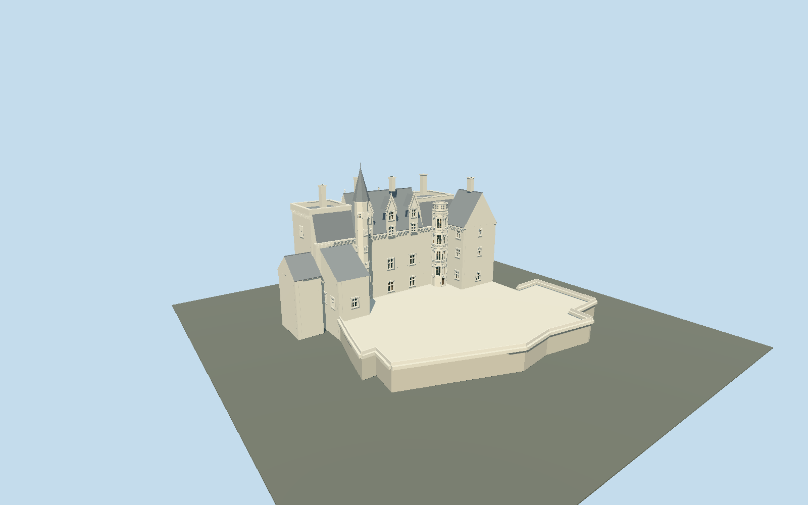

# Château de Montsoreau

Tuffeau Loire castle with river-facing square terrace towers, asymmetric return wings, four northern and three courtyard Gothic dormers, slate roofs, machicolations, western pointed stair roof and eastern Renaissance stair with slate-disc balustrade.

## Evidence and reconstruction

Published dimensions and reconstructed details are separated in spec.json. Primary references:

- [Reference](https://gertrude.paysdelaloire.fr/dossier/IA49009670)
- [Reference](https://www.chateau-montsoreau.com/wordpress/fr/100-chateau-100-contemporain/le-chateau/)
- [Reference](https://pop.culture.gouv.fr/notice/merimee/IA49009670)
- [Reference](https://www.openstreetmap.org/way/175416989)

No third-party geometry, photograph or bitmap texture is embedded. Shared surface graphs come from the central library; vertex tints carry model colors. Glazing uses PBR materials; transparent surfaces are declared per model.

## Model and axes

39,291 triangles; 77,685 vertices; 7 material groups; 3,272,248 bytes. Native bounds: -31.600, 0.000, -27.150 to 32.490, 38.400, 27.205. Source hash: `sha256:545b3950f0000b764e16c017048f9e40e96d1164d98cc15b38c5078ab5049c2f`.

{"up":"+Y","longitudinal":"+X east along the signed cached precinct frame","front":"-Z toward the Loire; +Z toward the courtyard","origin":"Cached precinct rectangle center at provisional road/base datum"}

The geographic proposal uses exact-QID OpenStreetMap evidence. Map-derived orientation and estimated architectural details require real-site visual review; preview eligibility is distinct from geographic/fidelity approval. Map attribution: © OpenStreetMap contributors, ODbL-1.0.

## Reproduce

Run `node packages/worldgen/scripts/generate-signature-towers.mjs --ids=chateau_de_montsoreau` (or add `--check`). The generator preserves manually edited masters by checking their baseline hashes. Import through the standard authored-model workflow with optimization disabled; then capture all QA cameras, including shared-surface views.

## Pending work

- Original detailed 3397240-byte /40797-triangle master remains preserved through packages/worldgen/scripts/montsoreau-castle-model.mjs#montsoreauStudy.build and exact hash sha256:240687e26cd3d6e3a759349ef19141ddba00b69ab800da659c8723431dc23a5f. A separate reviewed source and four browser levels correct the occupied plan against fresh OSM building way 135334005 inside exact-QID castle precinct 175416989. Main river range, two open terrace towers, four river/three courtyard dormers, west pointed stair, east Renaissance stair with two slate-disc rows, asymmetric lower returns, narrow chimneys and open raised court remain. Five canonical shared limestone, raw limestone, slate, wood and painted-metal graphs plus opaque glass/recess supply seven near groups and no embedded images. Skyline uses graph mean colours in one draw, skyline omits sub-6 m retaining parapet segments; district omits reveals and fine carving, street uses framed planar trims, close uses stone cross/reveal and wood sash detail with simplified crockets. Published 35 m terrace height has an unresolved datum; provisional 21 m eave/30.8 m ridge/28.48 m terrace parapet/38.4 m stair finial and 4.5 m court are photographic working elevations, not surveys. Renaissance figures, heraldic panels, exact moldings and carved cross finials remain schematic; no interiors, movable shutters or replicated third-party textures. Window/roof proportions, terrace-floor sections, irregular external footprint edges and actual terrain/road/moat junctions remain approximate. Physical laptop/phone and dense-city timings remain unmeasured. Actual render inspection caught inward retaining faces; all are corrected to face outward and a triangulated downward base closes the raised court at ground. The Renaissance stair upper cap is replaced by an annular trim around the exposed terrace floor at district, street and close levels; skyline keeps a solid coarse cap within its stated error budget.

This bundle follows the medium-fi standard. Medium-fi appearance and geographic fit are reviewed separately. Hash-bound visual acceptance is recorded separately after capture inspection.
