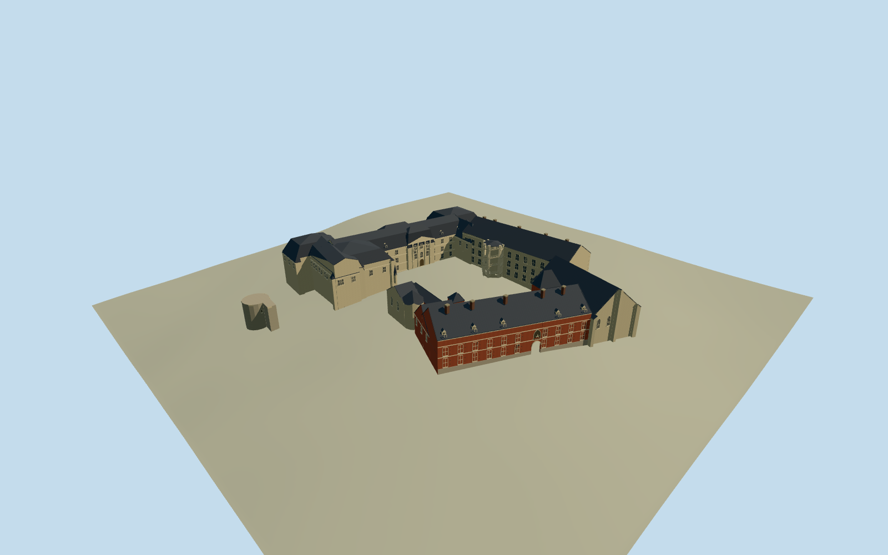

# Château of Blois

The Royal Château of Blois with its four historic wings, François I loggias and open court stair, brick Louis XII entrance, Gaston d’Orléans frontage, chapel and Foix tower.

Authoring state: **review-in-qa.json**. Current completion evidence is in [qa.json](qa.json) and the [completion ledger](../../../../qualla-structures/batches/qualla-004.PROGRESS.md).

- [Château of Blois](https://qualla.com/chateau-of-blois/)

Mapped roof and part heights are approximate. Courtyard grades, fine sculpture and details of partially hidden elevations are interpreted. Interiors and unrelated neighboring buildings are outside the model.

Build: `node content/worldgen/source/places/u0/u02/chateau_of_blois/models/generate-chateau-of-blois.mjs`. Add `--check` to verify exact regeneration. 29239 triangles; 6 materials; no embedded photographs.
