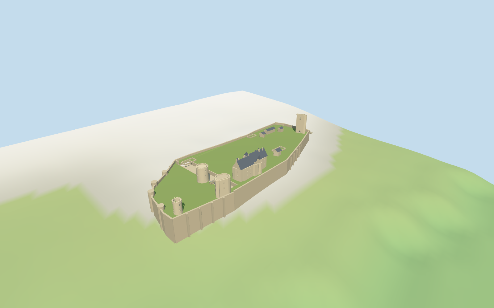

# Chinon Castle

Individual Chinon ridge fortress: irregular retaining enclosure and open grounds, roofless western round tower, flat-sided south tower, broad interior round keep, low western bastions, surviving royal lodging with steep slate roofs and stair projections, separate narrow clock gate and both mapped entrance crossings. Exterior openings, ruined partitions and clock faces appear in the appropriate browser levels.

## Evidence and reconstruction

Published dimensions and reconstructed details are separated in spec.json. Primary references:

- [Reference](https://www.valdeloire-france.com/app/uploads/2023/05/chinon-0072-gillard-et-vincent-crtcentrevdl-1024x767.webp)
- [Reference](https://putidorogi-nn.ru/images/stories/evropa/zamok_shinon_2.jpg)

Five existing256-square graphs provide limestone, rubble, slate, wood and painted metal. Lawn and modest blue-grey glazing are plain linear vertex colors. Seven near draws keep the five reusable graphs and two plain surfaces distinct; no unique bitmap or embedded picture.

## Model and axes

10,852 triangles; 32,556 vertices; 7 material groups; 1,306,332 bytes. Native bounds: -129.631, -19.972, -51.199 to 162.716, 36.100, 51.199. Source hash: `sha256:6469d053e12e507d4a118b16bbd54dcb114ecf9bd26dabbb487aa8d395df2242`.

{"x":"eastward along fortress ridge","y":"up","z":"southward toward town"}

Main fortress envelope, distinct component plans and actual bridged footways establish approximate placement; western round/polygonal towers, lodging ridge and eastern gate confirm signed facing.

## Reproduce

Run `node packages/worldgen/scripts/generate-additional-landmarks.mjs --ids=N0317` (or add `--check`). The generator preserves manually edited masters by checking their baseline hashes. Import through the standard authored-model workflow with optimization disabled; then capture all QA cameras, including shared-surface views.

## Pending work

- Heights, wall thicknesses, curtain tops, room remnants and terrace are picture-led approximations; buried archaeology and complete interiors are not reconstructed.
- The two reference photographs show differing lodging roof states. The roofed photograph guides the current slate treatment; no historical dating is inferred.
- Main enclosure and clock gate are modeled. Separate eastern visitor building and archaeological foundations beyond the entrance are excluded from this exterior scope.
- The coarse standard viewer DEM blends the ridge. Retaining skirt, authored plateau, bridge profiles and entrance joins are approximate; no runtime terrain carving, surveyed ground contact or certified walkable collision is claimed.
- Physical laptop and phone frame-rate measurements remain pending.

This bundle follows the medium-fi standard. Medium-fi appearance and geographic fit are reviewed separately. Hash-bound visual acceptance is recorded separately after capture inspection.

## Additional geographic data

© OpenStreetMap contributors; Protomaps; Mapzen/USGS terrain tiles.
