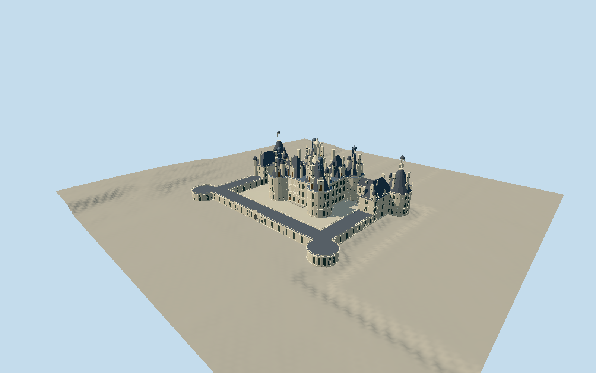

# Château de Chambord

Connected native château with open courtyard: square keep/four great round towers, four separate steep hipped pavilion roofs, central open stone lantern to56m, six restored open corner lanterns, chapel/royal side wings, recessed connecting galleries and low enclosure/two flat front towers. Three-storey pilaster/moulding facade grid, crossed windows and upper open gallery bays, true courtyard entrance portal, supported exterior circular staircases, native roof dormers/chimneys/stair turrets with original restrained circular/diamond inlays and abstract relief. Current2025 aerial controls silhouette and restored blue-grey lead; older close photos control stone/window forms. Gardens, detached buildings, moat, interiors, people and photo textures excluded.

Authoring state: **review-in-qa.json**. Current completion evidence is in [qa.json](qa.json) and the [local 100 ledger](../../../../qualla-structures/batches/PROGRESS.md).

- [Chateau de Chambord](https://qualla.com/chateau-de-chambord/)

Eight local originals individually inspected and all40 candidate contact views reviewed. Historical facade/plan engravings, interiors, Quebec, Montsoreau, Schwerin, Waddesdon and Zamosc do not control the current Chambord exterior.

Main connected château, keep/four drums, chapel/royal wings and two tall outer towers, low court enclosure/two flat front towers, current roof skyline and immediate thresholds only. Moats, formal gardens, bridges in the park, detached service buildings, interiors, trees, people, cars and flag cloth excluded.

Current2025 aerial controls overall massing and restored lantern finish. Earlier2007–2013 photos control visible stone/window details, not current lead polychromy or gilding. Original simplified abstract carving only, no literal heraldry or inscriptions.

Nominal156m frontage and56m central lantern height are owner controls. Native connected outline is approximately157.1×112.5m; preserve it rather than forcing a nominal bounding rectangle. Other heights and fine dimensions are map/photo estimates, not surveys.

Independent unchanged IGN provider terrain was acquired and verified before geometry. The 2m review grid and 0.01m response rounding do not establish effective native resolution or surveyed accuracy. Default coarse Terrarium compatibility is not certified; use a compatible host field. Footprint replacement disabled.

Four authored levels simplify small details: distant applied windows and reduced lantern/roof ornament; street exterior stairs use a helical ramp; close uses actual treads and open landing shafts. Balusters, stair arcade columns, crown tracery, chimney relief and thresholds are original proportional approximations, with no interior or engineering reconstruction.

Build: `node packages/worldgen/scripts/generate-authored-places.mjs --ids=chateau_de_chambord`. Add `--check` to verify exact regeneration. 63940 triangles; 8 materials; no embedded photographs.
