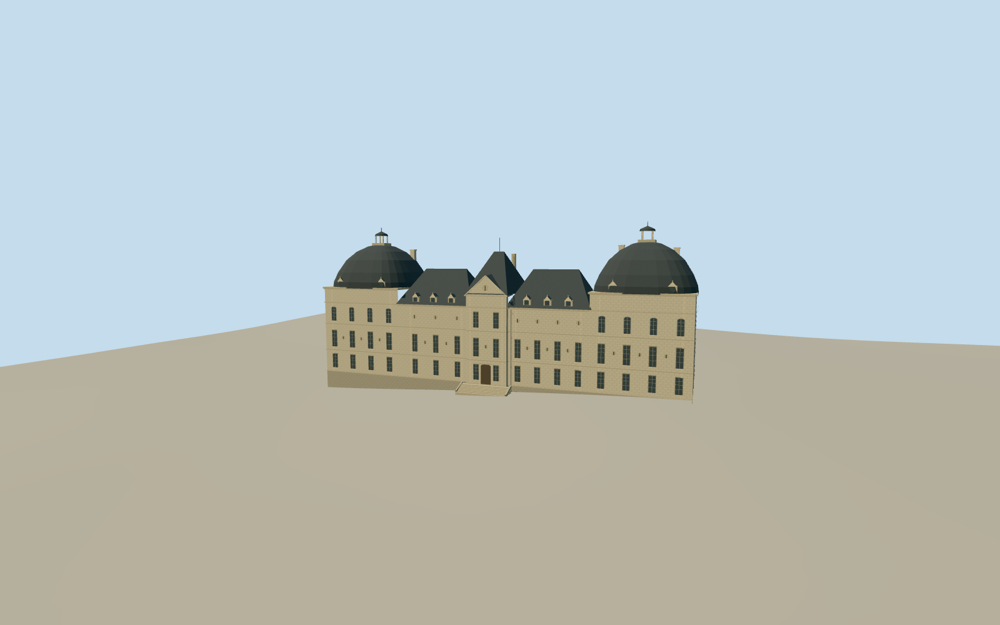

# Château de Cheverny

Château de Cheverny around 2010, with a pale limestone facade, tall square pavilions, curved slate roofs, open lanterns and a short broad front stair.

Authoring state: **review-in-qa.json**. Current completion evidence is in [qa.json](qa.json) and the [completion ledger](../../../../qualla-structures/batches/qualla-003.PROGRESS.md).

- [Chateau de Cheverny](https://qualla.com/chateau-de-cheverny/)

The 2010-era south elevation is reconstructed from one exact released photograph and cadastral geometry. Rear fenestration, individual stone carvings, chimney sections, roof profile and vertical measurements are approximate.

The source terrain is unchanged. The east lawn samples are higher than the west side, so foundation exposure varies. The central threshold and step fit are approximate. The historic park, kennels, original outbuildings and interiors are outside scope.

Build: `node content/worldgen/source/places/u0/u03/chateau_de_cheverny/models/generate-cheverny-chateau.mjs`. Add `--check` to verify exact regeneration. 4413 triangles; 3 materials; no embedded photographs.
