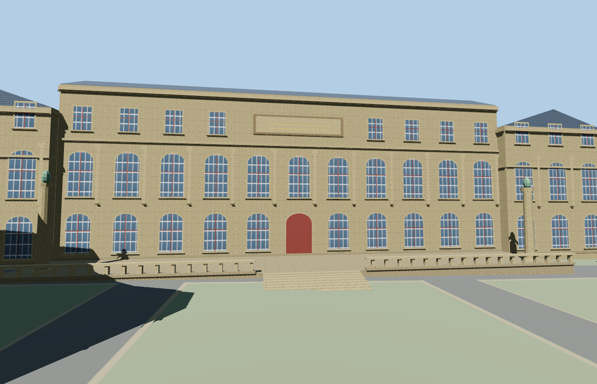

# Beaux-Arts de Paris

Mapped Beaux-Arts de Paris campus with the Palais des Études and glazed court, amphitheatre apse, Loges wing, Hôtel de Chimay, Perret galleries, Petits-Augustins chapel, Rue Bonaparte gateway and the open Cour du Mûrier cloister.

The 34,376-triangle source master rebuilds from the editable geometry. The four runtime levels have 490, 3,722, 14,358, 32,564 triangles. Skyline and district total 365,968 bytes. All six GLBs validate with zero errors, warnings or embedded images.

The viewer replaces all 24 school footprint records and preserves 580 neighboring building records, 373 road records, terrain, water and land cover. All four levels keep the four open courtyards and the raised glass roof. District through close-up preserve eight tested cloister openings, the hall floor and the eight terrace steps. A failed load retains the original campus footprints. All loaded model geometry disposes on eviction.

Inspected 26 geographic and 12 standalone views. The campus massing, major courtyard openings and orientation follow PMTiles. The architectural heights where map data is absent, the terrace and decorative details are approximations from reference pictures. The standard terrain rises above the actual street grade in parts of the city. Publicly visible exteriors and the glazed court are modeled. Collections, enclosed teaching rooms, and readable inscriptions are simplified. Physical-device timings remain unmeasured.

Run `node packages/worldgen/scripts/generate-beaux-arts-de-paris.mjs --check --ids=beaux_arts_de_paris` to confirm the source rebuild.
