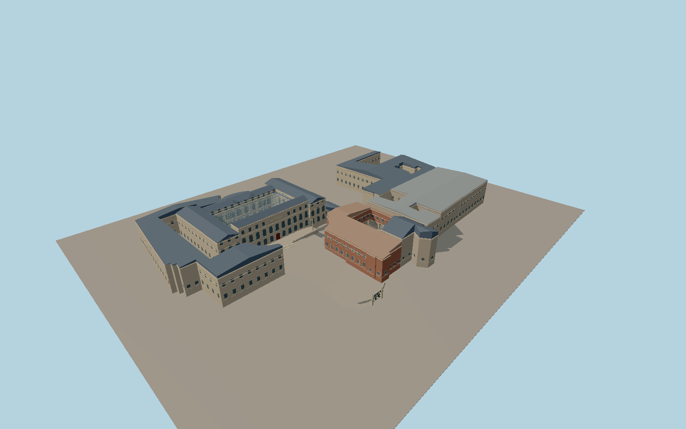

# Beaux-Arts de Paris

Mapped Beaux-Arts de Paris campus with the Palais des Études and glazed court, amphitheatre apse, Loges wing, Hôtel de Chimay, Perret galleries, Petits-Augustins chapel, Rue Bonaparte gateway and the open Cour du Mûrier cloister.

Run `node packages/worldgen/scripts/generate-beaux-arts-de-paris.mjs` to rebuild the source master. Append `--check` to compare the exact bytes. Use `--ids=beaux_arts_de_paris` for targeted import, LOD generation and placement.

The campus envelope and two courtyard holes follow PMTiles. Reference pictures guide the building heights where map data is absent, roof breaks, entrances, facade bays, and shared-material tints.

The model includes the visible glazed hall, cloister, and public exterior. The enclosed teaching rooms, collections and readable inscriptions are simplified. Standard viewer terrain is an approximation of the urban site.

Original geometry follows the repository license. Map data is © OpenStreetMap contributors under ODbL-1.0 via Protomaps. Terrain samples are described in terrain-grid.json. Ordinary pictures stay local and are not redistributed or used as textures. Current acceptance is recorded in qa.json.
