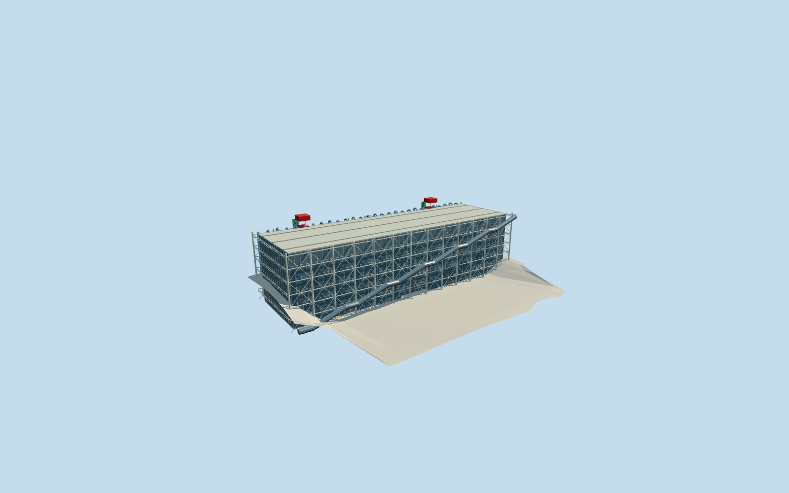

# Centre Georges Pompidou

Centre Georges Pompidou exterior with the glazed core, pale cantilevered frame, western escalator, Forum entrance, eastern service pipes and sloping granite piazza. The Brancusi studio, surrounding streets and neighboring buildings retain native map geometry.

## Evidence and reconstruction

Published dimensions and reconstructed details are separated in spec.json. Primary references:

- [Reference](https://www.centrepompidou.fr/fr/offre-aux-professionnels/espace-presse/le-centre-pompidou-x-parana)
- [Reference](https://www.macval.fr/MAC-VAL-X-Centre-Pompidou)
- [Reference](https://commons.wikimedia.org/wiki/File:Apud_la_Centro_Georges-Pompidou_3.jpg)

Centre Georges Pompidou exterior with the glazed core, pale cantilevered frame, western escalator, Forum entrance, eastern service pipes and sloping granite piazza. The Brancusi studio, surrounding streets and neighboring buildings retain native map geometry.

## Model and axes

46,857 triangles; 140,163 vertices; 5 material groups; 5,611,580 bytes. Native bounds: -100.789, -6.490, -95.499 to 62.691, 43.060, 93.069. Source hash: `sha256:eafbc9bfb5947521a6b32d27474a7c097d937f33ef55e1ea19252bffb4a669c1`.

{"x":"east","y":"up","z":"south"}

The geographic proposal uses exact-QID OpenStreetMap evidence. Map-derived orientation and estimated architectural details require real-site visual review; preview eligibility is distinct from geographic/fidelity approval. Map attribution: © OpenStreetMap contributors, ODbL-1.0.

## Reproduce

Run `node packages/worldgen/scripts/generate-additional-landmarks.mjs --ids=centre_georges_pompidou` (or add `--check`). The generator preserves manually edited masters by checking their baseline hashes. Import through the standard authored-model workflow with optimization disabled; then capture all QA cameras, including shared-surface views.

## Pending work

- Centre Georges Pompidou exterior with the glazed core, pale cantilevered frame, western escalator, Forum entrance, eastern service pipes and sloping granite piazza. The Brancusi studio, surrounding streets and neighboring buildings retain native map geometry.
- Named Centre Georges Pompidou POI and building share native35184427592229/OSM way55503397. Internal+X runs south-southwest along the mapped long side, +Z points west-northwest toward the piazza. The escalator rises toward the south end as observed in the frontal west photo. World heading0; orientation is baked into east/south model coordinates. Only this independent museum record is replaced.
- Mapped main building height42m and 167.14m long side are controls. Reconstructed45m glazed core, fourteen structural stations, seven floor/roof lines, approx49m high service-tower caps, tube radius1.55m and pipe/member dimensions are picture-led approximations, not engineering measurements. Mechanical inventories, roof plant and hidden facade details are simplified; furnished galleries, working escalators, copied lettering and event artwork omitted.
- Standard Protomaps PMTiles z15 and Mapzen Terrarium z14. Sample at the upper piazza and retain the measured host seam along all four edges. The modeled granite plaza descends toward the Forum on an 11% central grade. Northern and southern transitions follow the adjacent ground; the eastern service strip follows street-side terrain. The Forum threshold height and the joins across the ends of the piazza are reconstructed from the museum description, photographs and standard terrain. The site fit is a visual approximation.

This bundle follows the medium-fi standard. Medium-fi appearance and geographic fit are reviewed separately. Hash-bound visual acceptance is recorded separately after capture inspection.
