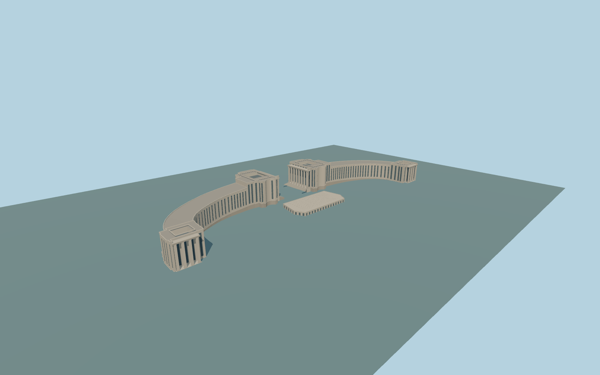

# Chaillot Palace

Complete original medium-fi Chaillot Palace exterior:both exact-map curved wings,both central andterminal pavilions,mapped low service annex,four real open column colonnades with closed recessed glazing behind,stepped flat parapet roofs with picture-guided inset roof wells,andlower central theater/terrace with tall stone piers/closed glazing. Broad central view axis remains open above the terrace;fountains,gardens,statues,bas-reliefs,inscriptions,interiors andindependent city remain native or excluded.

Rebuild: `node packages/worldgen/scripts/generate-chaillot-palace.mjs`;append `--check` for exact source bytes. Select import/LOD/placement with `--ids=chaillot_palace`. Detailed source and four browser tiers are separate ignored GLB outputs.

Complete original medium-fi Chaillot Palace exterior:both exact-map curved wings,both central andterminal pavilions,mapped low service annex,four real open column colonnades with closed recessed glazing behind,stepped flat parapet roofs with picture-guided inset roof wells,andlower central theater/terrace with tall stone piers/closed glazing. Broad central view axis remains open above the terrace;fountains,gardens,statues,bas-reliefs,inscriptions,interiors andindependent city remain native or excluded.

Approximate66m global terrain datum. Central pavilion floors67.3m;terminal floors61.6m;curved wing floors/rooflines grade smoothly between these bounded levels. Heights androof wells are ordinary-picture/native-map interpretations,not a survey. Three unmodified global terrain tiles. Four bounded native-field approaches;no general hill flattening. Lower theater terrace is a picture/path-guided original footprint because current PMTiles does not supply its underground/terrace outline.

Two actually inspected ordinary pictures:one broad aerial andone central-pavilion end facade. Rear elevations,concealed roof/terrace interfaces,roof well depth,window/column inventory andhistoric levels are approximate. Sculpture,bas-reliefs andtext excluded. No private image textures. Physical-device timings andnumerical LOD errors remain unmeasured.

Five existing shared256px limestone,granite,gravel,painted-metal andwindow-grid graphs;six material slots. Metric UVs/linear colors;no private or embedded images. Four authored browser tiers preserve both actual curved wings/four pavilions,four open colonnades andlow theater terrace. District window proxies,street closed recesses,close-up cornice/column trim androof wells,fine source mullions/coffers. Skyline simplifies each eight-column portico to four supports. Roof wells are picture-guided andretain aclosed glazed base rather than expose invented interiors. Physical timings andnumerical LOD errors remain unmeasured.

Original geometry:repository license. Map:© OpenStreetMap contributors,ODbL-1.0;Protomaps. Standard terrain:terrain-grid.json. Ordinary pictures stay local and are not redistributed or used as textures. Current acceptance:qa.json.
