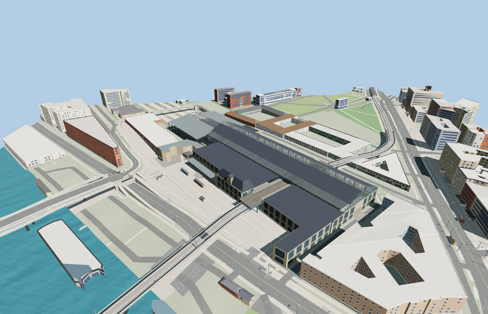

# Gare d’Austerlitz

The Seine clock pavilion and limestone wings frame the glazed historic hall. Iron lattice roof trusses and the Métro 5 crossing remain visible over the public concourse. The southern shed covers four mapped platforms and eight surface tracks.

The 30,387-triangle source rebuilds byte for byte. Skyline, district, street and close-up use 764, 3,512, 15,367, 28,363 triangles. Skyline and district total 364,488 bytes. Six GLBs validated and 38 current views were inspected.

The model replaces eight mapped station parts and preserves 168 surrounding buildings and 590 transportation records. All four tiers pass checks for nine open doorway samples, four hall passages, four platform roofs and decks, four elevated Métro sections, eight surface rail passages and four surrounding terrain samples. Ground, water and landcover restore on unload.

The station shows the heritage envelope, restored hall and above-ground transport arrangement. Construction equipment, temporary diversions, underground levels and future retail changes are outside the modeled scope. The 52-meter historic clear span follows SNCF documentation. Heights, façade recesses and the elevated Métro deck section are photo- and terrain-based reconstructions. The fitted hall floor and station-end railway grades follow the standard viewer terrain approaches. The modeled elevated Métro deck covers the station crossing and its immediate ends.

Rebuild with `node packages/worldgen/scripts/generate-gare-dausterlitz.mjs`. Append `--check` to compare exact bytes. Use `--ids=gare_dausterlitz` for targeted import, LOD, placement and readiness.
