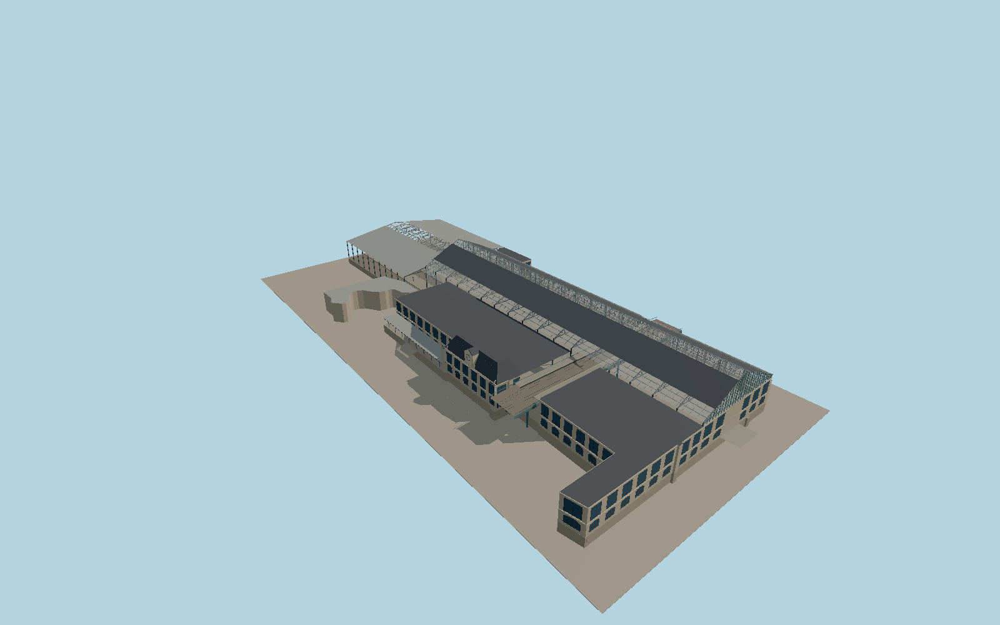

# Gare d’Austerlitz

The Seine clock pavilion and limestone wings frame the glazed historic hall. Iron lattice roof trusses and the Métro 5 crossing remain visible over the public concourse. The southern shed covers four mapped platforms and eight surface tracks.

Run `node packages/worldgen/scripts/generate-gare-dausterlitz.mjs` to rebuild the source master. Append `--check` to compare the exact bytes. Use `--ids=gare_dausterlitz` for targeted import, LOD generation and placement.

The station shows the heritage envelope, restored hall and above-ground transport arrangement. Construction equipment, temporary diversions, underground levels and future retail changes are outside the modeled scope.

The 52-meter historic clear span follows SNCF documentation. Heights, façade recesses and the elevated Métro deck section are photo- and terrain-based reconstructions.

The fitted hall floor and station-end railway grades follow the standard viewer terrain approaches. The modeled elevated Métro deck covers the station crossing and its immediate ends.

Original geometry follows the repository license. Map data is © OpenStreetMap contributors under ODbL-1.0 via Protomaps. Terrain samples are described in terrain-grid.json. Local photographs serve as visual references for the authored geometry. Current acceptance is recorded in qa.json.
