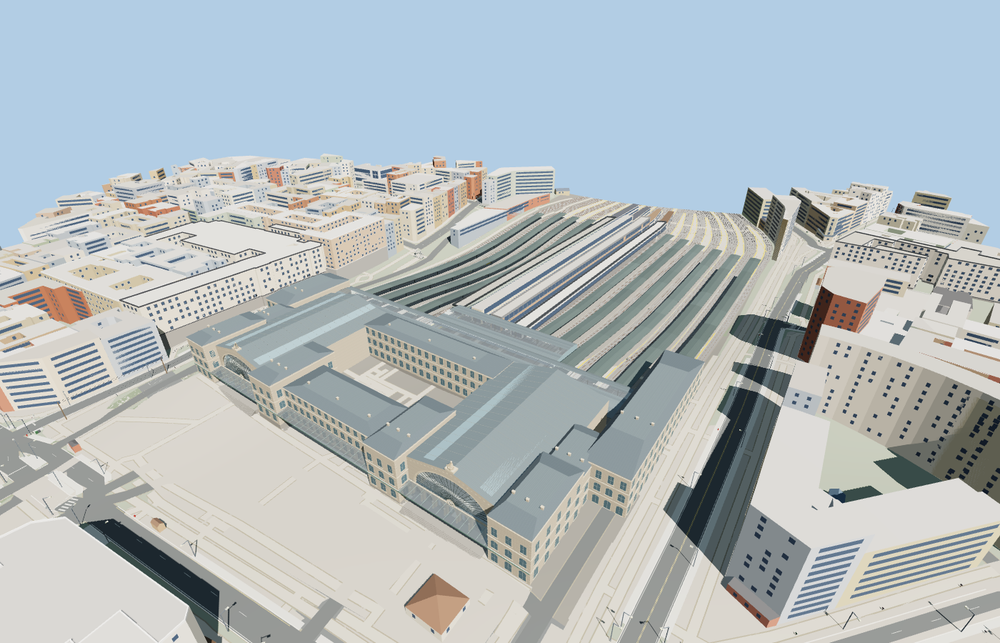

# Gare de Paris-Est

The Strasbourg and Verdun pavilions frame paired limestone gables, glazed fanlights, clocks and seated city figures. Their open arcades sit beneath the south marquise. A transverse concourse links the fourteen separately roofed platforms while the track gaps remain open.

The 64,141-triangle source rebuilds byte for byte. Skyline, district, street and close-up use 758, 3,880, 15,669, 63,997 triangles. Skyline and district total 436,492 bytes. Six GLBs validated and 37 current views were inspected.

The model replaces the terminal footprint and preserves 526 surrounding buildings and 1187 transportation records. Fourteen platforms, twenty-eight open track probes, two pavilion entrances, twelve stair samples, four foundations and four concourse ridge probes pass at each level. The procedural terminal returns if loading fails.

The main terminal footprint, its signed axis and the track pairs follow Protomaps PMTiles. The model uses the standard 52 m sea-level terrain datum. Most exterior heights and the long shelter terminations are photo estimates. The fourteen platform islands and their roofs follow sampled terrain and mapped rail spacing. The two seated city figures, clock reliefs and platform fittings are modeled at viewing scale. Interior rooms and temporary station works are outside the exterior scope. The single-tile above-ground review retains tunnel records and excludes standalone bore geometry because the tile does not contain complete underground routes.

Rebuild with `node packages/worldgen/scripts/generate-gare-de-paris-est.mjs`. Append `--check` to compare exact bytes. Use `--ids=gare_de_paris_est` for targeted import, LOD, placement and readiness.
