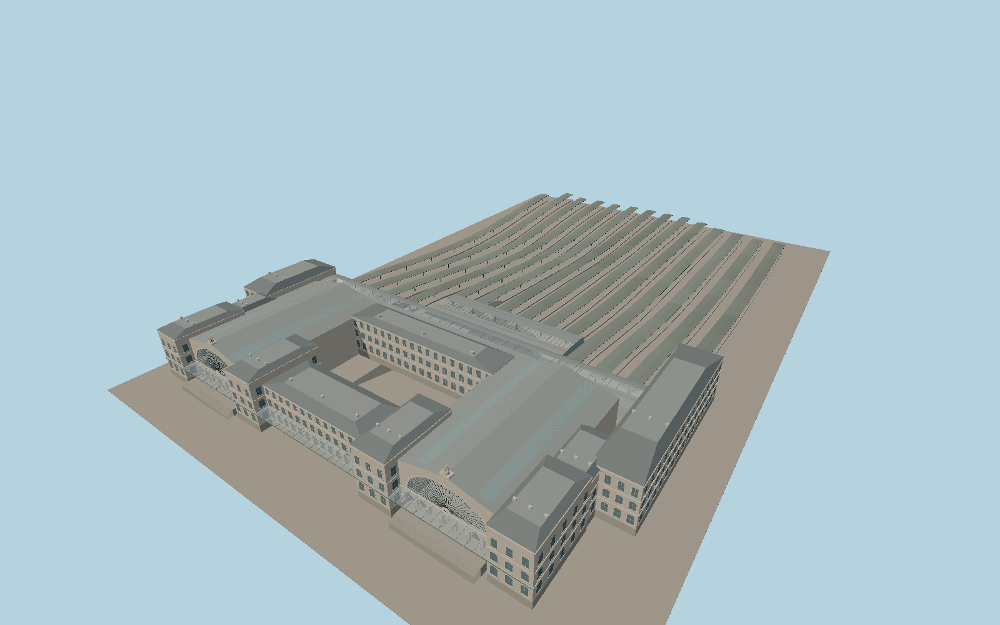

# Gare de Paris-Est

The Strasbourg and Verdun pavilions frame paired limestone gables, glazed fanlights, clocks and seated city figures. Their open arcades sit beneath the south marquise. A transverse concourse links the fourteen separately roofed platforms while the track gaps remain open.

Run `node packages/worldgen/scripts/generate-gare-de-paris-est.mjs` to rebuild the source master. Append `--check` to compare the exact bytes. Use `--ids=gare_de_paris_est` for targeted import, LOD generation and placement.

The main terminal footprint, its signed axis and the track pairs follow Protomaps PMTiles. The model uses the standard 52 m sea-level terrain datum. Most exterior heights and the long shelter terminations are photo estimates.

The fourteen platform islands and their roofs follow sampled terrain and mapped rail spacing. The two seated city figures, clock reliefs and platform fittings are modeled at viewing scale. Interior rooms and temporary station works are outside the exterior scope.

Original geometry follows the repository license. Map data is © OpenStreetMap contributors under ODbL-1.0 via Protomaps. Terrain samples are described in terrain-grid.json. Ordinary pictures stay local and are not redistributed or used as textures. Current acceptance is recorded in qa.json.
