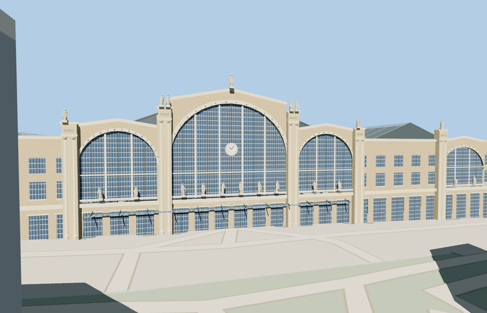

# Gare du Nord

Gare du Nord with its limestone south front, five principal glazed arches, clock, city figures, stone wings, iron-and-glass train sheds, platform furniture and open northern train throat.

The 39,725-triangle source rebuilds byte for byte. Skyline, district, street and close-up use 887, 3,530, 15,478, 37,185 triangles. The first two tiers total 352,960 bytes. Six GLBs validated and 38 current views were inspected.

All four tiers preserve the three roof ridges, clear north train throat and south entrance alignment. The viewer retains 240 independent buildings and 84 rail records. The failed-load view restores the three native station polygons.

Roof slopes, masonry details, city figures and structural ironwork are visual reconstructions from ordinary photographs. The mapped footprint fixes the position and signed orientation. Platform slabs and column feet adapt to the coarse viewer elevations. The model retains the native rail paths, approach roads and surrounding buildings. The small annex volume follows its mapped plan with an approximate roof height. Below-ground concourses, signage schedules and working trains are outside the exterior scope. Physical-device timings are unmeasured.

Rebuild with `node packages/worldgen/scripts/generate-gare-du-nord.mjs`. Append `--check` to compare exact bytes. Use `--ids=gare_du_nord` for targeted import, LOD, placement and readiness.
