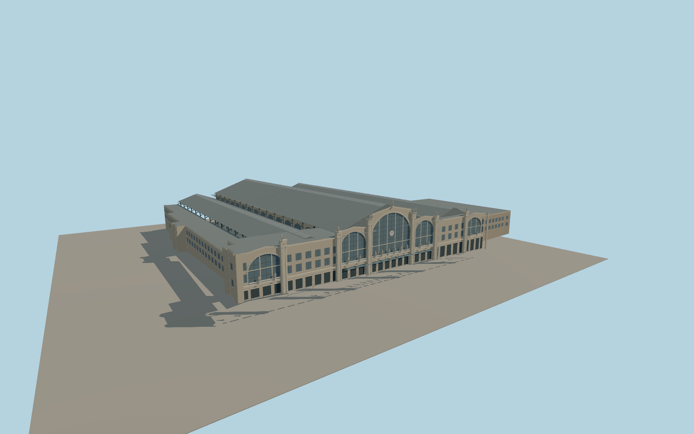

# Gare du Nord

Gare du Nord with its limestone south front, five principal glazed arches, clock, city figures, stone wings, iron-and-glass train sheds, platform furniture and open northern train throat.

Run `node packages/worldgen/scripts/generate-gare-du-nord.mjs` to rebuild the source master. Append `--check` to compare the exact bytes. Use `--ids=gare_du_nord` for targeted import, LOD generation and placement.

Roof slopes, masonry details, city figures and structural ironwork are visual reconstructions from ordinary photographs. The mapped footprint fixes the position and signed orientation.

Platform slabs and column feet adapt to the coarse viewer elevations. The model retains the native rail paths, approach roads and surrounding buildings. The small annex volume follows its mapped plan with an approximate roof height. Below-ground concourses, signage schedules and working trains are outside the exterior scope.

Original geometry follows the repository license. Map data is © OpenStreetMap contributors under ODbL-1.0 via Protomaps. Terrain samples are described in terrain-grid.json. Ordinary pictures stay local and are not redistributed or used as textures. Current acceptance is recorded in qa.json.
