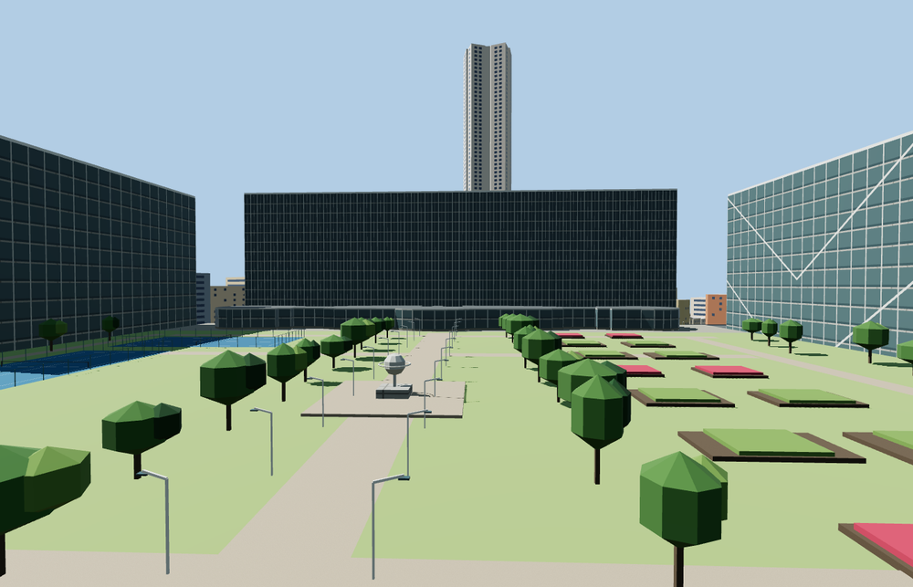

# Gare Montparnasse

Porte Océane has a bowed glass entrance between concrete piers and a ribbed podium roof beneath the CNP slab. Jardin Atlantique sits between the side slabs above eleven platform islands, two side platforms and twenty-four mapped rail alignments. The curved Pasteur overbuild has an open central atrium.

The 34,575-triangle source rebuilds byte for byte. Skyline, district, street and close-up use 796, 3,596, 15,933, 32,955 triangles. Skyline and district total 406,900 bytes. Six GLBs validated and 38 current views were inspected.

The model replaces 24 mapped station and office parts and preserves 383 surrounding buildings and 1259 transportation records. All four tiers pass checks for three entrance openings, three garden heights, the CNP roof, 24 rail passages, four portal samples, three ceiling samples and four outside terrain samples. Ground, water and landcover restore on unload.

Standard PMTiles controls the mapped exteriors, roof court footprints and 24 rail alignments. The heights of the entrance, train floor and park deck are reconstructed from the photographs and standard viewer terrain. The model includes the main public entrance volume and the covered track passages. Shop interiors, transit operations, planting schedules and restricted station interiors are outside this model. The garden and forecourt follow the photographed configuration. The separate Tour Montparnasse remains a neighboring landmark.

Rebuild with `node packages/worldgen/scripts/generate-gare-montparnasse.mjs`. Append `--check` to compare exact bytes. Use `--ids=gare_montparnasse` for targeted import, LOD, placement and readiness.
