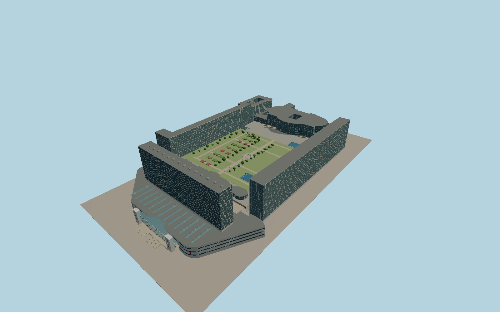

# Gare Montparnasse

Porte Océane has a bowed glass entrance between concrete piers and a ribbed podium roof beneath the CNP slab. Jardin Atlantique sits between the side slabs above eleven platform islands, two side platforms and twenty-four mapped rail alignments. The curved Pasteur overbuild has an open central atrium.

Run `node packages/worldgen/scripts/generate-gare-montparnasse.mjs` to rebuild the source master. Append `--check` to compare the exact bytes. Use `--ids=gare_montparnasse` for targeted import, LOD generation and placement.

Standard PMTiles controls the mapped exteriors, roof court footprints and 24 rail alignments. The heights of the entrance, train floor and park deck are reconstructed from the photographs and standard viewer terrain.

The model includes the main public entrance volume and the covered track passages. Shop interiors, transit operations, planting schedules and restricted station interiors are outside this model.

The garden and forecourt follow the photographed configuration. The separate Tour Montparnasse remains a neighboring landmark.

Original geometry follows the repository license. Map data is © OpenStreetMap contributors under ODbL-1.0 via Protomaps. Terrain samples are described in terrain-grid.json. Ordinary pictures stay local and are not redistributed or used as textures. Current acceptance is recorded in qa.json.
