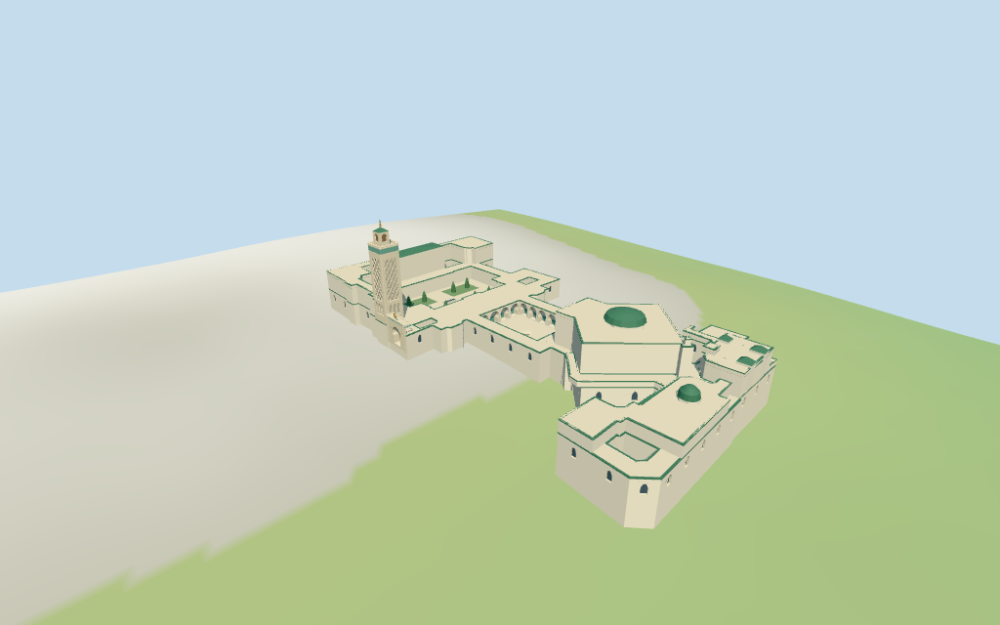

# grand_mosque_of_paris — Grand Mosque of Paris

Reviewed2026-10-17 against current bytes. Accepted for the stated medium-fi exterior and approximate horizontal fit. Identity uses the named current mosque POI/location/pictures;no exact-QID building match. Untagged profiles,unpictured roofs,current canopy/finish and exact terrain contacts remain approximate or unverified.

## Exterior and shared surfaces

Inspected all11 current portable frames,including the1024×640 summary. Cream square minaret with recessed broad diamond lattice,green upper frieze/crenellations,small lantern/pyramid/stacked-orb finial;horseshoe portal/crescent and outlined star;garden beds/coarse cypresses/basin;white horseshoe patio arcades and central bowl;prayer hall/selected tall glazing/green roof cap and ancillary ranges. Removed the initial eave/roof strip crossing the portal,softened lattice back panels from dark timber to limestone,and added selected prayer glazing. Fine carving,exact planting,unpictured roofs/current finish and terrain joins remain approximate or unverified.

Inspected all11 current shared/geographic-flat frames. Six existing256² lime plaster,limestone,ceramic roof,mosaic,plain wood and bronze graphs;eight merged groups. Cream surfaces,pale flat roofs,green eaves and sparse gold use metric UVs and linear tints;glass/water local blue-grey. Planting reuses the wall group with green vertex tints. No embedded images,baked lighting/weathering or copied carving/inscriptions. Six graphs read once;unload zero live model geometries. Geographic fixture flat;portable/medium-fi retain raw standard DEM. Streets and independent neighbours remain host content.

## Browser levels

| Level | Triangles | Bytes | Draws |
| --- | ---: | ---: | ---: |
| skyline | 962 | 94,652 | 1 |
| district | 3,797 | 344,836 | 8 |
| street | 13,418 | 1,244,468 | 8 |
| closeup | 15,354 | 1,446,196 | 8 |

Initial skyline plus district: **439,488 bytes**. Master **1,909,584 bytes /15,874 triangles**;runtime **1,908,876 bytes**. Six shared256² graphs,eight groups,zero embedded images;shared textures additional.

Inspected all27 current medium-fi frames:Economy/High,noon/late,three distances,silhouette,six details,four matched levels/four transitions. Skyline962 retains the square minaret/green band/lantern,principal ranges,prayer roof cap,portal and seven plan voids;coarsens small jogs,omits selected overlapping tiny parts,windows,plants/lattice and patio bays. District3797 adds true coarse patio bays,recessed tower fields,flat facade glazing and simple planted beds;omits paired columns and fine eave strips. Street13418/close15354 add true glazing recesses,columns,selected blind arches/lattice/trim. Corrected coarse flat roofs from green to pale paving so roof colour remains consistent during upgrades. Fixed the skyline roof-dome classification after polygon simplification;all six GLBs now independently pass slope and green-palette probes at the prayer cap. Initial439488bytes plus shared textures;one/eight draws. Separate POSITION/NORMAL;CPU/GPU reservations equal. Synthetic context and physical-device timing remain unverified.

## Placement and scope

Earlier catalog supplied only reference location[2.355,48.841944444] and Q392564,without resolved exact-QID footprint. Current standard PMTiles named POI35184809901725 (Grande Mosquée de Paris /Grand Mosque of Paris) falls inside current whole52776558703101 and matches the pictured square minaret/garden/courtyard complex. Building polygons have no exact Wikidata tag. This is a reviewed name/location/picture approximation,not an exact-QID map identity claim. Original reference anchor retained;heading0.212938848480713rad derives from the long patio edge,no horizontal scaling. Whole70-point outer/seven separate holes and all selected raw part polygons/properties retained. Main entry is estimated on the western whole edge beside the mapped minaret;exact doorway facing/parcel and unpictured component use remain unverified. Retained height/width/length fact arrays are empty. Map whole5m is a low envelope;parts retain mapped5/6.5/8/11/12.5/14/15.5/17m ranges and minaret27m base,27–31m lantern and31–33m top. Untagged wall/roof splits,gate7.9m,courtyard arcades5m,recesses,lattice/merlons,finials and roof shapes are picture estimates within about1.5m;estimated entry facing within5°. Low overlapping5m components remain retained without being reinterpreted as extra roof heights. No map or fact dimensions invented. Bath/ancillary roof profiles,current finish,interiors and engineering unverified. Standard viewer DEM datum46.473735m;perimeter-2.76..3.02m relative to anchor. Working floor3.358m is maximum bilinear footprint sample at2m spacing plus0.25m,not surveyed paving. Raw DEM retained without cutout/flattening;adaptive footings crossY=0 below terrain. Exact thresholds/ramps/garden/patio/terrain joins and free walking unverified. All444 actual viewer-footprint checks cover28 selected controls and preserve46 separate hosts across source/runtime/four levels. All344 raw points/properties independently reunited from PMTiles;whole70-point outer/seven holes retained. Named mosque POI lies inside whole;building polygons have no exact Q392564 tag.1306 bilinear terrain samples and patio-derived heading verified. Accepted as approximate name/location/picture identity and horizontal fit,not exact-QID or doorway/survey approval.

Individual medium-fi Grand Mosque of Paris complex:cream square minaret with broad recessed diamond-lattice abstraction,green frieze/crenellations,smaller lantern/pyramidal top/three-orb finial;green roof edges,white horseshoe entry portal,open garden with broad planted beds/basin and white horseshoe patio arcades/central bowl. Mapped prayer hall/roof dome and ancillary ranges retain their component plans/envelopes. Six shared256² graphs,eight merged groups,four authored browser levels. Pictures guide signature forms;fine carving/calligraphy,exact planting/ornament and2016 temporary transparent courtyard cover are omitted. Untagged subdivisions,unpictured roofs/baths,current finish and precise terrain/threshold contacts remain approximate or unverified. Retained height/width/length fact arrays are empty. Map whole5m is a low envelope;parts retain mapped5/6.5/8/11/12.5/14/15.5/17m ranges and minaret27m base,27–31m lantern and31–33m top. Untagged wall/roof splits,gate7.9m,courtyard arcades5m,recesses,lattice/merlons,finials and roof shapes are picture estimates within about1.5m;estimated entry facing within5°. Low overlapping5m components remain retained without being reinterpreted as extra roof heights. No map or fact dimensions invented. Bath/ancillary roof profiles,current finish,interiors and engineering unverified. Standard viewer DEM datum46.473735m;perimeter-2.76..3.02m relative to anchor. Working floor3.358m is maximum bilinear footprint sample at2m spacing plus0.25m,not surveyed paving. Raw DEM retained without cutout/flattening;adaptive footings crossY=0 below terrain. Exact thresholds/ramps/garden/patio/terrain joins and free walking unverified. Square shaft to27m,lantern27–31m and top31–33m retain mapped envelopes. Whole5m is not a cap on taller parts. Low5m overlapping components stay retained without adding5m to another roof. Estimated gate7.9m/crest10m,patio5m,roof/wall splits,window cadence,lattice/merlon counts,selected planting/basins and unpictured ancillary/bath roofs remain approximations. Minaret carved fields use broad original diamond beams rather than copied carving;portal artwork is abstracted. Patio bays close on tiled aisle backs;portal and glazing close before rooms. Temporary transparent canopy visible in2016 omitted,current cover state unverified. Precise altitude/threshold/ramp/garden/patio/terrain joins,walking,interiors,current finish,engineering and physical-device performance unverified. No bespoke surveys or redistributed pictures.

## Verification

**49 current views inspected;654 geometry probes;444 footprint checks.** Six Khronos validations:zero errors/warnings/images. Targeted byte reproduction,scene validation,30-tick simulation and current source/input/recipe/runtime/LOD/capture/material bindings pass. Six graphs read once;unload zero live model geometries. Current package builds reused;next full source checkpoint great_mosque_of_aleppo–great_mosque_of_xi_an.

Source: sha256:ce461f316f17e0520371112c5262eb736ea6af92d310cb8b64596d87955348a1

Runtime: sha256:55c995481fe8123c8109b17e61622a77c163a9df1b5e52ba81c53c25adeecdcb

Input: sha256:87ec6153eb5dd2f9c15d719148a778c11e8f0951ad63e830eabb36cb0c06c22f

Simulation: sha256:f0d1eb7ab0cabd219e6663dca810b29f98dddc15c2d90d4eca40e3076735975d

Commands:targeted generate/import/LOD/register --ids=grand_mosque_of_paris;generate --check;portable reflections/antialias/fitted shadows;shared reflections/adaptive clipping/bounded placement;medium-fi reflections;scene validate/sim30;recipe-only Biome check. Bulk captures ignored.

## Inspected pictures

[Madorielaoshi — 2011-08-03](https://commons.wikimedia.org/wiki/File:Grande_Mosquée_de_Paris_-_Minaret.jpg). CC-BY-SA-3.0. Viewed minaret from garden:cream square shaft with large recessed diamond-pattern fields,lower blind arches,green mosaic upper band,crenellated terrace,smaller square lantern/pyramidal cap and stacked orb finial. White garden walls/green eaves,planted beds and elongated basin. Fine carving/planting abstracted.

[Guilhem Vellut — 2016-12-04](https://commons.wikimedia.org/wiki/File:Courtyard_@_Grande_Mosquée_de_Paris_@_Paris_(31328106061).jpg). CC-BY-2.0. Viewed white horseshoe patio arcades on paired slender columns,green tiled eaves/dark timber upper frieze,blue-green tiled lower back walls and broad pale paving/central bowl. Temporary transparent truss canopy seen2016 is omitted from this fixed exterior reconstruction;current cover state unverified.

[Guilhem Vellut — 2015-12-13](https://commons.wikimedia.org/wiki/File:Entrance_of_Mosquée_de_Paris,_13_December_2015.jpg). CC-BY-2.0. Viewed western principal entrance adjacent to minaret:cream shoulders and horseshoe recessed opening,mosaic upper strip,stepped crenellated top,sparse paired side windows,steps and gold crescent/outlined star. Fine inscriptions/floral carving and exact threshold/ramp geometry omitted.

[Pergl Pergl — 2015-09-21 (metadata;filename says20September)](https://commons.wikimedia.org/wiki/File:Mosquée_de_Paris,_Rue_Geoffroy-Saint-Hilaire,_20_September_2015.jpg). CC-BY-2.0. Viewed long pale street elevation with rough stone base,green tile eaves,three tall dark arched fields,smaller side windows and timber-fronted porch rhythm. Green pyramidal roof/orb finial appears behind wall. Wall/roof profiles and selected exterior windows approximated;fine grilles/lanterns omitted.
