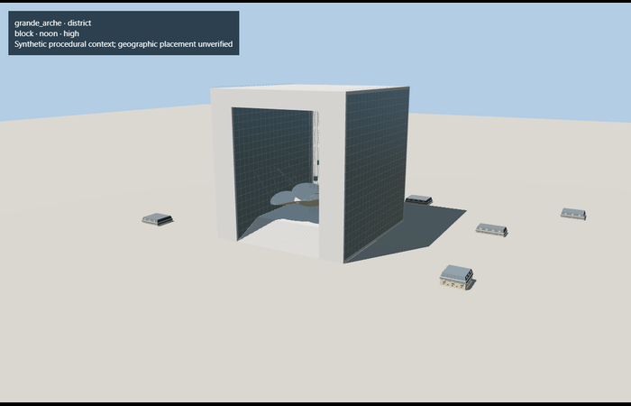

# Grande Arche — reviewed medium-fi exterior

Refreshed 2026-10-27. **25 current medium-fi views inspected; 20 unchanged portable/shared/geographic views retained with exact input/output/pixel proofs.** Six current GLBs have zero validator errors/warnings. The detailed master and street/closeup geometry are unchanged. The new skyline and district roof-edge joints preserve the open arch, piers, top beam, stair terrace, lifts and reconstructed canopy. All four levels were inspected under the shipped ACES 1.05 lighting rig.

| Level | Triangles | Bytes | Draws |
| --- | ---: | ---: | ---: |
| Skyline |822|69820|1|
| District |3064|246344|4|
| Street |15688|1234012|4|
| Close-up |23716|2324540|4|

Initial skyline-plus-district download **316,164 bytes**. Canonical granite, painted metal and fabric graphs are shared; glazing remains local PBR. The three existing geometry/source tests pass, including original-face preservation, the open upper span and deterministic four-level reproduction. The detailed source remains 23,716 triangles. This refresh retains the geographic scope and reconstruction limits below; it adds no claim of surveyed native parvis fit.

## References and geographic fit

[Ministry heritage record](https://pop.culture.gouv.fr/notice/merimee/ACR0000683) supports the106.9×112×110.9m dimensions and post2017 granite. [Paris La Défense operator photographs](https://www.parisladefense.com/en/district/towers-buildings/grande-arche) show the open monument, panelled soffit and suspended cloud. Photographs were inspected privately and are not redistributed.

[Attributed map feature](https://www.openstreetmap.org/way/19441489) identifies Q216357. Anchor2.23587465,48.8925645; model heading1.0106030674398965. Map +X denotes depth; source native axes swap by90degrees exactly once. +Z122.095°SE faces Paris. The geographic flat-ground fixture confirms outline, signed rotation and unload. Host terrain must supply the parvis datum.

## Accepted limits

Cloud/opening dimensions, step count and car elevations are reconstructed. Internal mural, roof furniture, interiors and measured parvis elevations are excluded. Authored LOD error reservations are not a formal whole-mesh deviation measurement. Exterior convex collision closes the open span for physics; it does not support walking through. Actual phone/laptop performance remains unmeasured.
