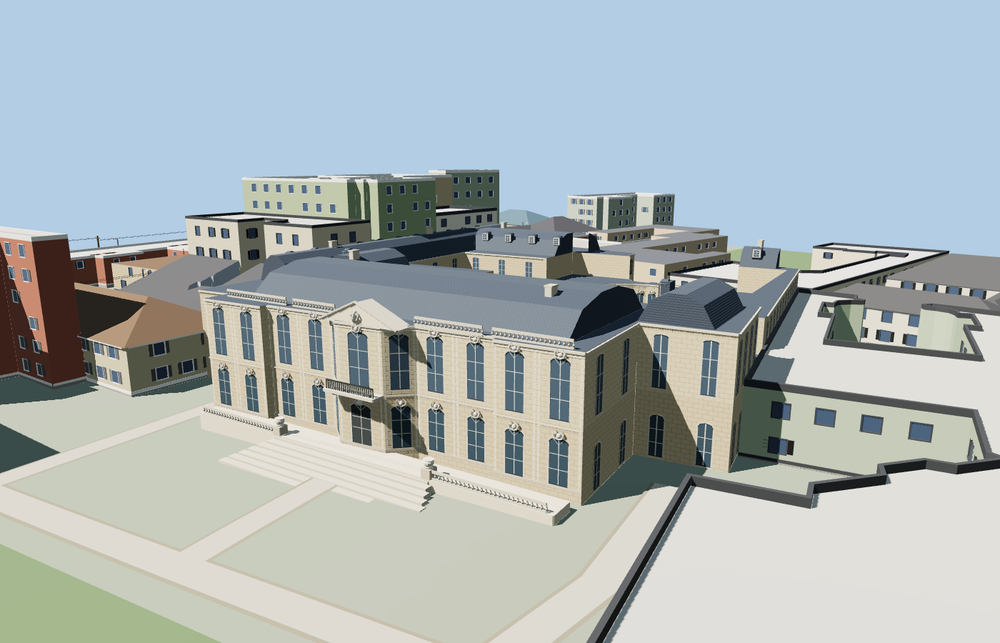

# Hôtel Matignon

Hôtel Matignon with its recessed Parisian courts, curved entrance arcade, ornate limestone garden front, slate mansards and broad stepped terrace.

The 46,447-triangle source rebuilds byte for byte. Skyline, district, street and close-up use 999, 3,863, 11,482, 46,447 triangles. The first two tiers total 368,400 bytes. Six GLBs validated and 38 current views were inspected.

Every tier passes six open-court, eight stair, three facade and 36 foundation probes. The viewer retains 63 independent building records and 42 mapped transportation parts. Failed loading retains the original mapped footprint.

The building outline and three open courts follow PMTiles. Ordinary photos guide window, stonework, roof and stair proportions. This is an exterior model. The glazed doors and windows depict the closed building, and the garden retains the viewer’s native terrain and land cover. Physical-device timings are unmeasured.

Rebuild with `node packages/worldgen/scripts/generate-hotel-matignon.mjs`. Append `--check` to compare exact bytes. Use `--ids=hotel_matignon` for targeted import, LOD, placement and readiness.
