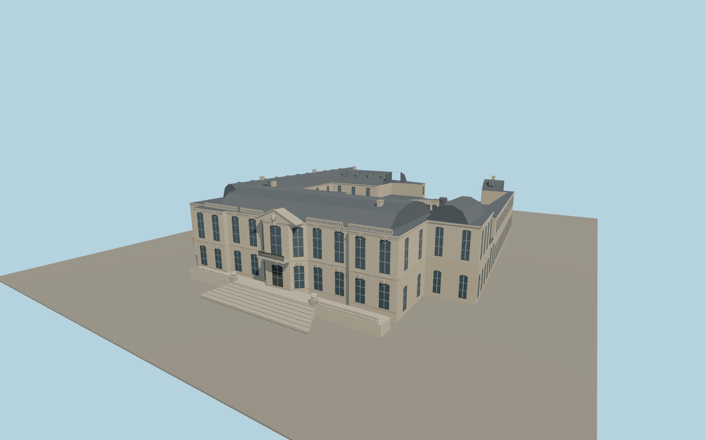

# Hôtel Matignon

Hôtel Matignon with its recessed Parisian courts, curved entrance arcade, ornate limestone garden front, slate mansards and broad stepped terrace.

Run `node packages/worldgen/scripts/generate-hotel-matignon.mjs` to rebuild the source master. Append `--check` to compare the exact bytes. Use `--ids=hotel_matignon` for targeted import, LOD generation and placement.

The building outline and three open courts follow PMTiles. Ordinary photos guide window, stonework, roof and stair proportions.

This is an exterior model. The glazed doors and windows depict the closed building, and the garden retains the viewer’s native terrain and land cover.

Original geometry follows the repository license. Map data is © OpenStreetMap contributors under ODbL-1.0 via Protomaps. Terrain samples are described in terrain-grid.json. Ordinary pictures stay local and are not redistributed or used as textures. Current acceptance is recorded in qa.json.
