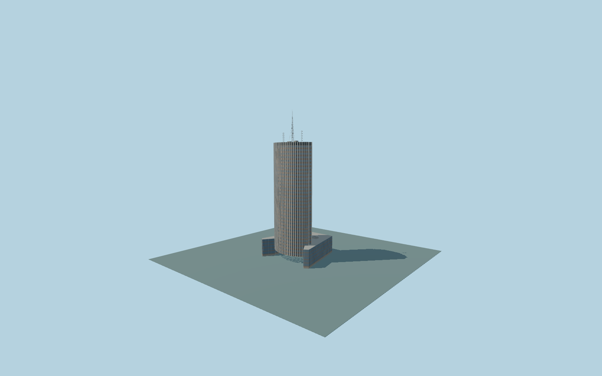

# Hyatt Regency Paris Etoile

Complete137m curved/lenticular Hyatt hotel withprojecting pale vertical piers,brown horizontal spandrels,recessed paired blue-gray windows,plain brown end returns,dark roof band andwhole21m low hotel podium/plant. Original reconstructed174m rooftop lattice/communications envelope andnorthern forecourt canopy/recessed vestibule/native stairs complete the approximate exterior.

Original source:models/hyatt-model.mjs,layout.json andattributed standard map/global-terrain controls. Rebuild with `node packages/worldgen/scripts/generate-hyatt-paris-etoile.mjs`;append `--check` for exact bytes. Import/LOD commands select `--ids=hyatt_regency_paris_etoile`. GLBs are ignored outputs.

Four existing shared256px graphs;no private or embedded images. Detailed master andfour browser tiers remain separate. Retained Q3142395 whole low parent andindependent137m curved tower/21m podium fix placement andscale. Native137–174m mast guides anoriginal antenna reconstruction;retained190m pinnacle statement andpresent-day communication inventory remain unresolved. No generic174m whole-parent extrusion orclaim ofa verified current antenna inventory. Northern entry androof/facade/canopy details are photo-proportional approximations. Separate Palais des Congres andapartments excluded.49m native center datum andoriginal grades are not surveyed. See model-brief.json andqa.json for complete scope/limits.

Original geometry uses repository license. Maps:© OpenStreetMap contributors,ODbL-1.0;Protomaps. Terrain hashes/attribution:terrain-grid.json. Linked ordinary photographs are not redistributed orused as textures.
