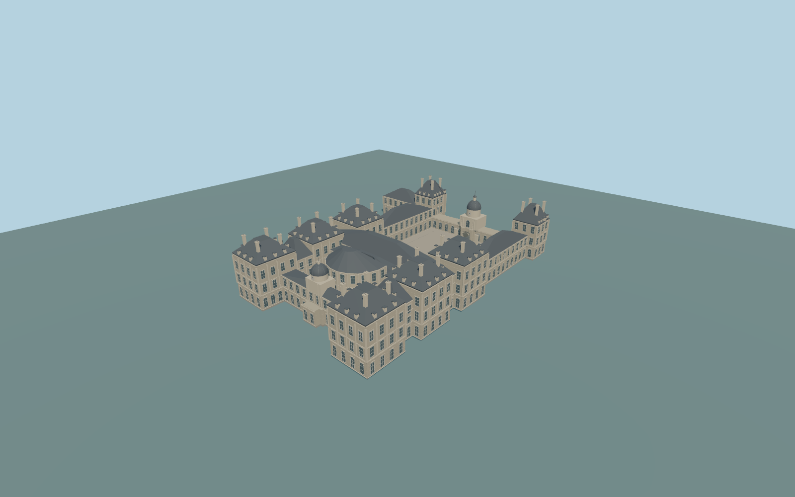

# Luxembourg Palace

Complete individual Luxembourg Palace exterior:large open north entrance court,low north crossrange withreal arched throughgate anddomed clocktower,eight mapped high pavilion roofs,connecting sidewings,transverse central block,rounded hemicycle roof,garden-front clock pavilion/lantern,two small open servicecourts andattached northwest return. Retain theindependentPetit Luxembourg,museum,roads,gardens andcitycontext.

Rebuild: `node packages/worldgen/scripts/generate-luxembourg-palace.mjs`;append `--check` for exact source bytes. Select import/LOD/placement with `--ids=luxembourg_palace`. Detailed source and four browser tiers are separate ignored GLB outputs.

Complete individual Luxembourg Palace exterior:large open north entrance court,low north crossrange withreal arched throughgate anddomed clocktower,eight mapped high pavilion roofs,connecting sidewings,transverse central block,rounded hemicycle roof,garden-front clock pavilion/lantern,two small open servicecourts andattached northwest return. Retain theindependentPetit Luxembourg,museum,roads,gardens andcitycontext.

Explicit nativewholeplan andheightbands keep allthree court voids;two servicecourts stayopen. Major roof masses interpret actualnative component heights andordinary pictures;not a generic palace replacement. Closed archwindows except actual northgate passage. Eighthigh pavilions plus north domed gate/garden clockcupola. Internal architecturalu/v transformed toretained nativeframe.

Approximate53m sea-level reference/53.8m court paving fromunmodified standard global Terrariumfield. Native tagged pavilion heights31.2m,main roofs26.7/28.2m,lowgallery8.6m andnorth dome25.7/lantern28.8m guide relativeproportions. Groundclip limited tooccupiedpalace/court paving;two tiny servicecourts excluded. Historic terraces/thresholds not surveyed.

Window/dormer/chimney inventory,sculpture,orders andhidden elevations original approximations. No copied insignia,flag graphics,lettering ordecorative statuary. No rooms/interior furnishing orentire gardens. Physicaldevice timing unmeasured.

Six existing256px limestone,granite,slate,painted-metal,window-grid andpainted-wood graphs;metric UVs/linearcolors. Skyline usescoarse roof/volume derivatives andretains allthree courts/north portal. District adds sparse closed glazing;street addsregular facade rhythm/dormers;closeupadds framing,orders,clock hands,chimneys/ribs. Masterretains denser profiles. Error estimates3/1.5/.7/.25m areunmeasuredapproximations;physicaltiming unmeasured.

Original geometry:repository license. Map:© OpenStreetMap contributors,ODbL-1.0;Protomaps. Standard terrain:terrain-grid.json. Ordinary pictures stay local and are not redistributed or used as textures. Current acceptance:qa.json.
