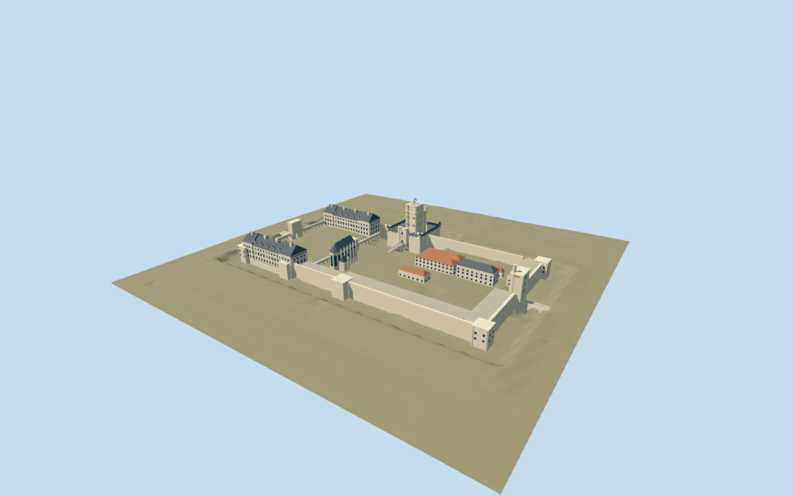

# Château de Vincennes

Present-day Vincennes compound: round-cornered tall keep and covered chemise, Gothic Sainte-Chapelle, Tour du Village, reduced enceinte towers, paired royal pavilions and open courts.

## Evidence and reconstruction

Published dimensions and reconstructed details are separated in spec.json. Primary references:

- [Reference](https://www.chateau-de-vincennes.fr/en/discover/una-fortaleza-real)
- [Reference](https://www.chateau-de-vincennes.fr/enseignants/mediatheque-espace-enseignant/fiche-de-visite)
- [Reference](https://www.chateau-de-vincennes.fr/en/discover/history-of-the-chateau-de-vincennes)
- [Reference](https://www.openstreetmap.org/way/23032971)
- [Reference](https://www.data.gouv.fr/datasets/bd-topo-r)

No third-party geometry, photograph or bitmap texture is embedded. Shared surface graphs come from the central library; vertex tints carry model colors. Glazing uses PBR materials; transparent surfaces are declared per model.

## Model and axes

12,434 triangles; 30,506 vertices; 5 material groups; 1,250,544 bytes. Native bounds: -199.000, -17.768, -105.970 to 202.000, 59.878, 114.000. Source hash: `sha256:73a2d7991dabc05b226c3a265cc4edbaf64009ee1c5287a610f77e342a44669a`.

{"up":"+Y","longitudinal":"+X NNE7.573347 degrees toward Village gate","front":"+Z ESE97.573347 degrees across main court","origin":"Mapped compound; Y0 retained RGE ALTI working datum53.6499m."}

Fresh way23032971 v26/Q663673 and14 stable IGN CLEABS plans agree within0.000687m rounding. Anchor[2.435779375,48.842783541], heading1.438616485431: +X NNE7.573347 degrees toward Tour du Village, +Z ESE97.573347 degrees across court toward Sainte-Chapelle. Keep west and Bois gate south sign frame. Retained actual Float32 RGE ALTI1m crop, working datum53.6499m, main/inner keep court0.8777m, chapel1.5419m and bounded foundations-12.5086m. Open courtyard controls set working floors; the crop interpolates moat heights across the raised keep court, so under-building cells are not floor observations. Published50m keep relative height retained; older BD TOPO absolute base/roof elevations disagree with this DTM and are not placement controls. Three bounded bridges meet sampled outside ground with reconstructed slopes. Two-meter diagnostic grid, uncertain current bridge/floor levels and acquisition date are recorded; no survey-accuracy claim, full-site slab, terrain cutout or navigable interior.

## Reproduce

Run `node packages/worldgen/scripts/generate-signature-towers.mjs --ids=N0265` (or add `--check`). The generator preserves manually edited masters by checking their baseline hashes. Import through the standard authored-model workflow with optimization disabled; then capture all QA cameras, including shared-surface views.

## Pending work

- Original12218-triangle/1225900-byte source reproduces at sha256:592f1d5e9c9b8943b3abe4f766ad797cff9cb5a18a0edc4d259167bd114b894f from unchanged vincennes-castle-model.mjs#buildVincennesRuntime and unchanged indexed IGN plan geometry.
- Fresh way23032971 v26/Q663673 and14 stable IGN CLEABS plans agree within0.000687m rounding. Anchor[2.435779375,48.842783541], heading1.438616485431: +X NNE7.573347 degrees toward Tour du Village, +Z ESE97.573347 degrees across court toward Sainte-Chapelle. Keep west and Bois gate south sign frame. Retained actual Float32 RGE ALTI1m crop, working datum53.6499m, main/inner keep court0.8777m, chapel1.5419m and bounded foundations-12.5086m. Open courtyard controls set working floors; the crop interpolates moat heights across the raised keep court, so under-building cells are not floor observations. Published50m keep relative height retained; older BD TOPO absolute base/roof elevations disagree with this DTM and are not placement controls. Three bounded bridges meet sampled outside ground with reconstructed slopes. Two-meter diagnostic grid, uncertain current bridge/floor levels and acquisition date are recorded; no survey-accuracy claim, full-site slab, terrain cutout or navigable interior.
- The DTM interpolates moat-height ground across the keep court and lower heights into some building footprints. The raised keep court and bounded foundations are reconstructed using open main-court controls, not a claim of surveyed floor levels.
- Older BD TOPO base/roof altitude fields disagree with this working DTM by up to several meters. Published relative keep height is retained; incompatible absolute roof fields do not control placement. Acquisition date and exact current entrance/bridge grades remain unverified.
- One-meter source and two-meter diagnostic sampling are not survey accuracy. Bounded foundations fill only architecture and the reconstructed inner court. No full-site slab or terrain cutout.
- Bridge slopes and masonry batters are bounded exterior reconstructions; no walkable interiors or exact present-day structural survey.
- Accepted reconstructed present-day exterior: tall four-round-turret keep and separate covered chemise, chapel single level with west rose and buttresses, Tour du Village, reduced perimeter towers, paired royal pavilions and ancillary ranges. Historical nine40m towers are not restored. Three gate arches and bridge under-spans are exterior voids; interiors and access permissions are not modeled.
- Original low tiers blocked public gate centers and truncated the keep approach bridge. Reviewed tiers retain keep chatelet, royal portico and Village/Bois gate voids. Keep approach extends to main court and all three bridges have bounded grade transitions. Detailed source bridge supports are preserved only in original master.
- Skyline omits minor service hut and chapel annex and uses coarse turret/canopy silhouettes. District restores building volumes and sparse openings; street and close-up restore rose, buttress, frame and roof detail. Door elevations, historical stair/bridge dimensions, masonry batters, flags, windows and roofs remain approximate.
- Three common graphs supply limestone, slate and ceramic tile. Local opaque PBR supplies glass and static flag/trim colors. Skyline bakes actual common linear means into one draw. No embedded or per-model copied bitmap textures. Physical laptop/phone timings and continuous-motion shimmer remain pending.

This bundle follows the medium-fi standard. Medium-fi appearance and geographic fit are reviewed separately. Hash-bound visual acceptance is recorded separately after capture inspection.

## Additional geographic data

© OpenStreetMap contributors, ODbL-1.0; © IGN BD TOPO, Licence Ouverte 2.0, retrieved 2026-10-07. Official CMN references are linked evidence only.
