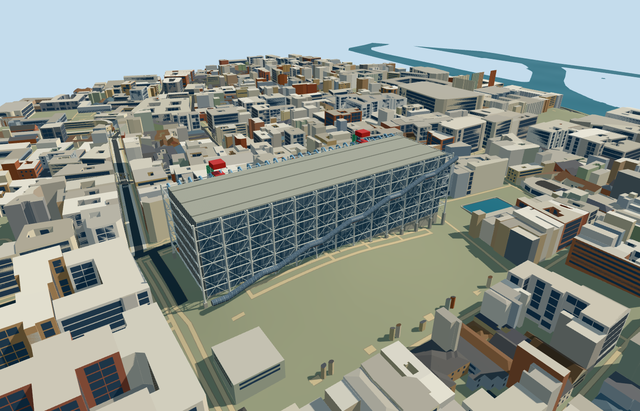

# N0749 — Centre Georges Pompidou

Reviewed 2026-10-22. **Authored exterior and runtime LODs reviewed; native placement remains an inactive terrain-fit draft.**

## Built and inspected

Picture-led medium-fi Pompidou exterior: exposed pale columns and tapered gerberettes, gallery glazing/floor lines, diagonal glazed western escalator tube with red underside and six rising flights/landings, eastern blue ducts/green service banks/yellow horizontal lines, two red stair-tower assemblies, large recessed intake mouths and roof spine. Reduced repeated structural work and hoops in distant LODs while retaining their identifiable locations and colors. Enduring exterior, not temporary renovation scaffolding. No copied pixels, signage, artworks or furnished galleries.

## Shared surfaces and browser LODs

Three existing 256px graphs: metal_painted for pale frame and all colored services, storefront for opaque reflective glazing, concrete_plain for roof and foundation. Eight authoring roles merge to three textured draws, one skyline draw. No new graph, private atlas or embedded image. Source fallback colors are linear; metric UVs and shared texture lifetimes preserved. Glass remains an opaque reflection proxy. Every requested graph reads once and every LOD unload releases all model geometry.

| Level | Triangles | Bytes | Draws |
| --- | ---: | ---: | ---: |
| skyline | 948 | 75,448 | 1 |
| district | 3,912 | 317,232 | 4 |
| street | 15,672 | 1,435,292 | 4 |
| closeup | 46,504 | 4,957,652 | 4 |

Four authored LODs contain 948 / 3,912 / 15,672 / 46,504 triangles. Initial skyline plus district geometry is 392,680 bytes; close-up is 4957652 bytes. All budgets pass, with separated POSITION/NORMAL streams and equal CPU/GPU memory accounting. Six valid GLBs, zero Khronos errors/warnings, 30 mesh/contact probes, three actual PMTiles overlap cases and 47 current inspected frames. Physical laptop/phone/tablet and dense-city timings remain pending.

## Geographic placement

Native placement fit rejected; keep this inactive draft. Q178065 and the named POI/building native35184427592229 identify OSM way55503397. Mapped long side is 167.14m; the approximate west facade/escalator and east service orientation follow that side, with heading0 baked into world east/south geometry. Three actual PMTiles levels13/14/15 cases pass. Successful controlled placement replaces only this museum and retains all 2,967 independent resident / 3,537 wider buildings. Original 201x201/6m grid, roads and 265,270.59m² of water remain unchanged. Only enclosed gallery core cuts ground; open frame, piazza and uncovered provider stay uncut. Failure retains all 2,968 resident buildings; every LOD unload restores ground/water and zero live model geometries. However the boundary grade spans -9.28m to +0.17m relative to the uncovered west control, overexposing the downhill foundation and column footings. The original coarse terrain does not reproduce the real lowered piazza/threshold levels. No custom terrain or broad flattening was used.

## Fidelity and limits

Standalone exterior reviewed as a medium-fi reconstruction; geographic completion remains pending. Mapped 42m height is an unqualified control. Core width45m, fourteen structural stations, approximate49m service caps, member diameters, tube radius1.55m, pipe inventories and hidden roof are inferred from ordinary pictures. Opaque glass, simplified red stairs and roof/mechanical assemblies are explicit proxies. Working escalators, museum interiors, exact plant inventories, temporary construction, fine inscriptions, exact thresholds/accessibility and engineering accuracy are omitted or unverified.

## Targeted checks

Selected generation/import/placement checks, strict medium-fi, scene validation, sim30 and recipe lint pass. Sim30 sha256:2aa45b15b5129a22cf5db46e5cc2c33511ee14333b9a7bc3acf4f9c4faa4f949. Current pins: [qa.json](qa.json). Editable controls: [map-frame.json](map-frame.json).

## Viewed references

- https://www.centrepompidou.fr/fr/offre-aux-professionnels/espace-presse/le-centre-pompidou-x-parana — Sergio Grazia (image filename credit; unavailable press page); date not identified; Copyright; viewed only; no pixels retained or incorporated. Viewed only.

- https://www.macval.fr/MAC-VAL-X-Centre-Pompidou — Photographer not identified on available image; MAC VAL publication; date not identified; Copyright; viewed only; no pixels retained or incorporated. Viewed only.

- https://commons.wikimedia.org/wiki/File:Apud_la_Centro_Georges-Pompidou_3.jpg — RG72; 2013-07-29; CC-BY-SA-4.0. Viewed only.

- https://www.openstreetmap.org/way/55503397 — named PMTiles building and POI, ©OpenStreetMap contributors, ODbL-1.0. No separate survey or bespoke terrain source.
