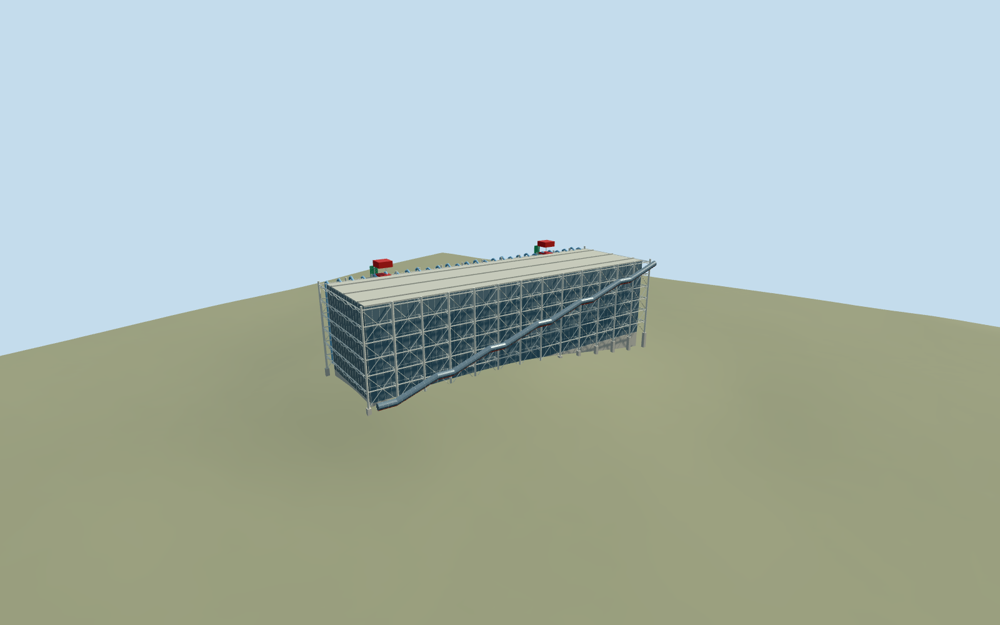

# Centre Georges Pompidou

Centre Georges Pompidou: independent mapped 42m gallery building with exposed pale structural columns and cantilevered gerberettes, six gallery levels, west piazza diagonal glazed/red escalator tube, east blue/green/yellow services, red stair towers and roof plant. Preserve the sloping piazza, Brancusi studio, IRCAM, independent ducts and all surrounding buildings. Enduring exterior inferred from ordinary photographs, not a depiction of temporary renovation works.

## Evidence and reconstruction

Published dimensions and reconstructed details are separated in spec.json. Primary references:

- [Reference](https://www.centrepompidou.fr/fr/offre-aux-professionnels/espace-presse/le-centre-pompidou-x-parana)
- [Reference](https://www.macval.fr/MAC-VAL-X-Centre-Pompidou)
- [Reference](https://commons.wikimedia.org/wiki/File:Apud_la_Centro_Georges-Pompidou_3.jpg)

Centre Georges Pompidou: independent mapped 42m gallery building with exposed pale structural columns and cantilevered gerberettes, six gallery levels, west piazza diagonal glazed/red escalator tube, east blue/green/yellow services, red stair towers and roof plant. Preserve the sloping piazza, Brancusi studio, IRCAM, independent ducts and all surrounding buildings. Enduring exterior inferred from ordinary photographs, not a depiction of temporary renovation works.

## Model and axes

46,504 triangles; 139,104 vertices; 4 material groups; 5,568,752 bytes. Native bounds: -58.682, -8.732, -88.479 to 58.864, 49.120, 88.479. Source hash: `sha256:08bdb815acb858df2d66788954eabd46fe486956398c64ce662d6ec268365cf5`.

{"x":"east","y":"up","z":"south"}

The geographic proposal uses exact-QID OpenStreetMap evidence. Map-derived orientation and estimated architectural details require real-site visual review; preview eligibility is distinct from geographic/fidelity approval. Map attribution: © OpenStreetMap contributors, ODbL-1.0.

## Reproduce

Run `node packages/worldgen/scripts/generate-additional-landmarks.mjs --ids=N0749` (or add `--check`). The generator preserves manually edited masters by checking their baseline hashes. Import through the standard authored-model workflow with optimization disabled; then capture all QA cameras, including shared-surface views.

## Pending work

- Centre Georges Pompidou: independent mapped 42m gallery building with exposed pale structural columns and cantilevered gerberettes, six gallery levels, west piazza diagonal glazed/red escalator tube, east blue/green/yellow services, red stair towers and roof plant. Preserve the sloping piazza, Brancusi studio, IRCAM, independent ducts and all surrounding buildings. Enduring exterior inferred from ordinary photographs, not a depiction of temporary renovation works.
- Named Centre Georges Pompidou POI and building share native35184427592229/OSM way55503397. Internal+X runs south-southwest along the mapped long side, +Z points west-northwest toward the piazza. The escalator rises toward the south end as observed in the frontal west photo. World heading0; orientation is baked into east/south model coordinates. Only this independent museum record is replaced.
- Mapped main building height42m and 167.14m long side are controls. Reconstructed45m glazed core, fourteen structural stations, seven floor/roof lines, approx49m high service-tower caps, tube radius1.55m and pipe/member dimensions are picture-led approximations, not engineering measurements. Mechanical inventories, roof plant and hidden facade details are simplified; furnished galleries, working escalators, copied lettering and event artwork omitted.
- Unmodified standard Protomaps20261020 and Mapzen201x201/6m terrain. Uncovered west piazza attachment at internal[0,38], datum59.41328128796627m. Gallery floor sits0.12m above that control; closed foundation reaches below original core boundary. Only the enclosed core cuts ground; open external frame, tube and piazza retain original terrain. Exact plaza grading/thresholds remain unverified.

This bundle follows the medium-fi standard. Medium-fi appearance and geographic fit are reviewed separately. Hash-bound visual acceptance is recorded separately after capture inspection.
