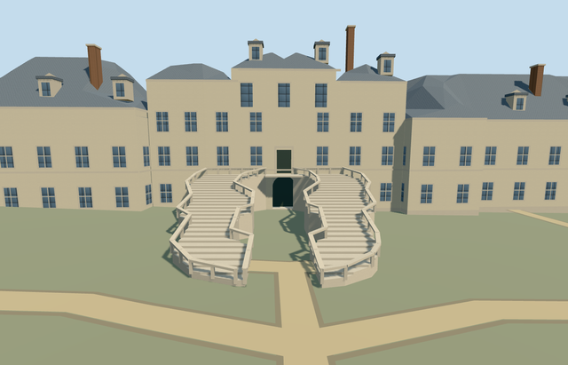

# N0759 — Palace of Fontainebleau

Reviewed2026-10-22. **Completed medium-fi principal palace exterior; qualified approximate native terrain fit.**

## Built and inspected

Principal palace exterior across the White Horse courtyard ranges/northern range, main front pavilion/two mapped curved horseshoe stair flights, Gallery of Francis I/Cour de la Fontaine, eastern oval court/chapel and northeast ranges. Open courts, pale masonry, crossed casements, steep slate roofscape/dormers and tall brick chimneys. Actual1.5m arched lower gate recess/soffit/threshold, separate4.9m upper landing/door and stepped flights with closed railings; nine2.7m recessed gallery arch bays with opaque back glazing as an exterior proxy. Hidden geometry/ornament reconstructed. Fixed the dark wall texture and unsupported pavilion projection in the same author/inspect pass.

## Shared materials and browser LODs

Five existing256px graphs shared by six textured roles/draws: stone_limestone_raw pale walls/trim, slate roof, brick_flemish stacks, storefront opaque crossed glazing and metal_painted static doors/dark trim. Generic limestone substitutes for exact historic masonry/weathering; plain pediments/fields omit sculpture/inscriptions. No new graph/private atlas/embedded images. One skyline draw, linear palette tints, separate POSITION/NORMAL streams and equal CPU-GPU accounting. Every native textured run reads each required graph once; all LOD unloads release model geometry.

| Level | Triangles | Bytes | Draws |
| --- | ---: | ---: | ---: |
| skyline | 843 | 82096 | 1 |
| district | 2658 | 247576 | 5 |
| street | 15231 | 1245368 | 6 |
| closeup | 29106 | 2355028 | 6 |

Four authored LODs 843 / 2658 / 15231 / 29106 triangles within1k/4k/16k/64k caps. Initial skyline+district geometry 329672 bytes; cached shared bakes separate. Six GLBs have zero Khronos errors/warnings;209 actual geometry/contact probes and24 actual PMTiles13/14/15 cases (19 detailed owned records) pass. Inspected48 current portable/shared/medium-fi/native frames across LODs and Economy/High noon/late light, including failed loading and unload restoration.

## Geographic placement

Q201428 and named way655065732 identify the palace. Standard map splits its principal exterior across eight further building footprints (including both mapped horseshoe flights) and northern relation12351522 plus nine integral building parts:19 owned records. Actual parent/part geometry supplies horizontal layout and open courts; parents outside this explicit set stay independent. Model anchor[2.699433515814212,48.40235043393468] shifts45m east/65m north of the old map-axis anchor to the main front range. InternalX south along the main facade; internalZ west toward the White Horse court. Native east/up/south geometry baked in, heading0. Approximate native exterior placement inspected on the original standard PMTiles/Mapzen201x201/6m grid. Uncovered White Horse court provider fixes datum76.83680555555556m, floor0.3m. Boundary grades-1.281..+3.502m leave modest low-side foundations and uphill/lower-arcade burial; the main horseshoe stair approach and lower entrance remain visible. Exact historic court paving, terrace/step levels, thresholds and accessibility are unverified. Original open courts,1,898 resident/2,283 wider independent buildings, roads and92,631.157534m² water retained. Failure keeps1,917 originals; all LODs must retain original terrain/water and restore ground on unload. No bespoke terrain research or custom flattening.

## Fidelity and limits

Photo-led exterior reconstruction from two ordinary pictures and mapped footprints. Most heights are absent; use8..20m working eaves, main front12.5m/central pavilion19m, gallery13.5m, south range11.5m, eastern chapel20m and northern range11.5m. Two northeast part tags5/8m are unqualified; exact eaves/ridges are not surveyed. Medial-ridge hip roofs reconstruct the complex unseen roof junctions; dome-like turrets are omitted where unsupported. Repeated windows/quoins/dormers/chimneys and plain pediments abstract the Renaissance detail. Horseshoe stair flights rise4.9m above the working floor; central lower arched gate1.5m recess and upper landing/door are distinct. Gallery has actual recessed arch bays. No copied ornament/artwork. Five existing256px graphs shared by six roles: stone_limestone_raw for pale walls/trim, slate, brick_flemish, storefront and metal_painted. Skyline preserves court holes and simplifies the lower range heights/footprints within5m; district rounds eaves and flattens portals; street has coarser roof ridges and fewer windows/dormers. The closeup preserves full mapped exterior topology. Ornament, sculpture, art and lettering are abstracted or omitted. The broad exterior is a medium-fi reconstruction. Most heights/eave/ridge levels, exact facade/bay/dormer/stack counts and unseen elevations/roof junctions are approximate. The northern relation and all19 map records are included; independent peripheral stable/administration buildings and garden/fountain context remain procedural. No furnished rooms, copied arms/inscriptions/sculpture/art, flags or walk-through gallery interior. Exact court grades/thresholds/accessibility and physical phone/laptop/dense-city timings remain unverified.

## Targeted checks

Selected generation/import/placement, strict medium-fi, scene/sim30 and recipe lint pass. Sim30 sha256:076f8ef25acf68821196d3eba04d7749ab562f4e6dd40aa163b9807af2d3dcaf. Current pins: [qa.json](qa.json); [source controls](map-frame.json).

## Viewed references

- https://commons.wikimedia.org/wiki/File:Chateau_de_Fontainebleau-Exterior009.jpg — Harmonia Amanda; 2005-08-15; CC-BY-SA-3.0. Viewed only; no copied pixels.

- https://commons.wikimedia.org/wiki/File:Ch%C3%A2teau_de_Fontainebleau,_cour_de_la_Fontaine.jpg — David Jouas; 2013-01-14; CC-BY-SA-3.0. Viewed only; no copied pixels.

- https://www.openstreetmap.org/way/655065732 — palace identity, explicit parent/part footprints and courtyard topology; ©OpenStreetMap contributors, ODbL-1.0. Standard PMTiles/Mapzen; no bespoke research.

## Completion checklist

- [x] Rebuildable source, import, four authored LODs and shared materials.
- [x] Current actual source/shared/native renders, geometry and lifecycle checks.
- [x] Unique map identity, signed orientation and approximate native exterior fit.
- [x] Open courts/approach, all independent buildings and original roads/terrain/water retained.
