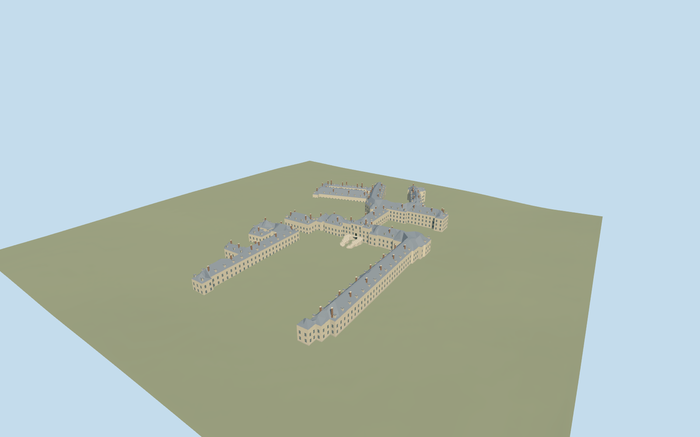

# Palace of Fontainebleau, principal exterior and horseshoe stairs

Principal exterior of the Palace of Fontainebleau, including the mapped White Horse courtyard ranges/north range, central pavilion and two curved horseshoe stair flights, Gallery of Francis I/Cour de la Fontaine ranges, eastern oval court/chapel and northeast service court ranges. Pale masonry, crossed casements, steep slate roofs/dormers and brick chimneys. Open courtyards and independent buildings remain. No furnished rooms, copied crests/inscriptions/sculpture, flags, gardens, fountain sculpture or peripheral stable/administration buildings.

## Evidence and reconstruction

Published dimensions and reconstructed details are separated in spec.json. Primary references:

- [Reference](https://commons.wikimedia.org/wiki/File:Chateau_de_Fontainebleau-Exterior009.jpg)
- [Reference](https://commons.wikimedia.org/wiki/File:Ch%C3%A2teau_de_Fontainebleau,_cour_de_la_Fontaine.jpg)

Principal exterior of the Palace of Fontainebleau, including the mapped White Horse courtyard ranges/north range, central pavilion and two curved horseshoe stair flights, Gallery of Francis I/Cour de la Fontaine ranges, eastern oval court/chapel and northeast service court ranges. Pale masonry, crossed casements, steep slate roofs/dormers and brick chimneys. Open courtyards and independent buildings remain. No furnished rooms, copied crests/inscriptions/sculpture, flags, gardens, fountain sculpture or peripheral stable/administration buildings.

## Model and axes

29,106 triangles; 66,658 vertices; 6 material groups; 2,752,888 bytes. Native bounds: -172.304, -1.431, -118.491 to 166.448, 26.320, 109.248. Source hash: `sha256:0b8716e6447f8291a9ba07d10f39352ac833c244b3ba97eabe135f1bbff277e2`.

{"x":"east","y":"up","z":"south"}

The geographic proposal uses exact-QID OpenStreetMap evidence. Map-derived orientation and estimated architectural details require real-site visual review; preview eligibility is distinct from geographic/fidelity approval. Map attribution: © OpenStreetMap contributors, ODbL-1.0.

## Reproduce

Run `node packages/worldgen/scripts/generate-additional-landmarks.mjs --ids=palace_of_fontainebleau` (or add `--check`). The generator preserves manually edited masters by checking their baseline hashes. Import through the standard authored-model workflow with optimization disabled; then capture all QA cameras, including shared-surface views.

## Pending work

- Principal exterior of the Palace of Fontainebleau, including the mapped White Horse courtyard ranges/north range, central pavilion and two curved horseshoe stair flights, Gallery of Francis I/Cour de la Fontaine ranges, eastern oval court/chapel and northeast service court ranges. Pale masonry, crossed casements, steep slate roofs/dormers and brick chimneys. Open courtyards and independent buildings remain. No furnished rooms, copied crests/inscriptions/sculpture, flags, gardens, fountain sculpture or peripheral stable/administration buildings.
- Q201428 and named way655065732 identify the palace. Standard map splits its principal exterior across eight further building footprints (including both mapped horseshoe flights) and northern relation12351522 plus nine integral building parts:19 owned records. Actual parent/part geometry supplies horizontal layout and open courts; parents outside this explicit set stay independent. Model anchor[2.699433515814212,48.40235043393468] shifts45m east/65m north of the old map-axis anchor to the main front range. InternalX south along the main facade; internalZ west toward the White Horse court. Native east/up/south geometry baked in, heading0.
- Photo-led exterior reconstruction from two ordinary pictures and mapped footprints. Most heights are absent; use8..20m working eaves, main front12.5m/central pavilion19m, gallery13.5m, south range11.5m, eastern chapel20m and northern range11.5m. Two northeast part tags5/8m are unqualified; exact eaves/ridges are not surveyed. Medial-ridge hip roofs reconstruct the complex unseen roof junctions; dome-like turrets are omitted where unsupported. Repeated windows/quoins/dormers/chimneys and plain pediments abstract the Renaissance detail. Horseshoe stair flights rise4.9m above the working floor; central lower arched gate1.5m recess and upper landing/door are distinct. Gallery has actual recessed arch bays. No copied ornament/artwork. Five existing256px graphs shared by six roles: stone_limestone_raw for pale walls/trim, slate, brick_flemish, storefront and metal_painted. Skyline preserves court holes and simplifies the lower range heights/footprints within5m; district rounds eaves and flattens portals; street has coarser roof ridges and fewer windows/dormers. The closeup preserves full mapped exterior topology. Ornament, sculpture, art and lettering are abstracted or omitted.
- Approximate native exterior placement inspected on the original standard PMTiles/Mapzen201x201/6m grid. Uncovered White Horse court provider fixes datum76.83680555555556m, floor0.3m. Boundary grades-1.281..+3.502m leave modest low-side foundations and uphill/lower-arcade burial; the main horseshoe stair approach and lower entrance remain visible. Exact historic court paving, terrace/step levels, thresholds and accessibility are unverified. Original open courts,1,898 resident/2,283 wider independent buildings, roads and92,631.157534m² water retained. Failure keeps1,917 originals; all LODs must retain original terrain/water and restore ground on unload. No bespoke terrain research or custom flattening.

This bundle follows the medium-fi standard. Medium-fi appearance and geographic fit are reviewed separately. Hash-bound visual acceptance is recorded separately after capture inspection.
