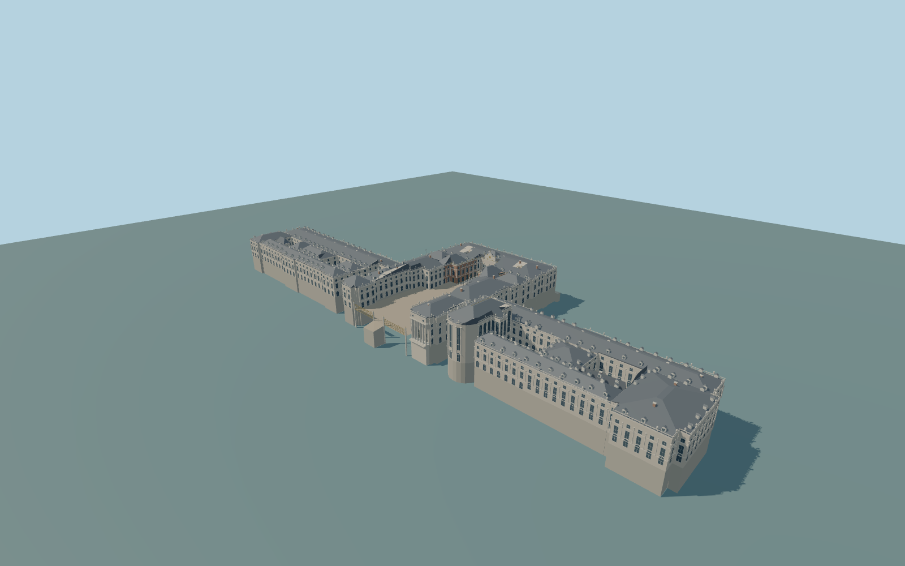

# Palace of Versailles

Complete individual principal Palace of Versailles: full north/south wings andseven enclosed courts,central garden corps de logis,open ceremonial approach/MarbleCourt withcentralclock/balcony,attached rounded RoyalChapel,distinct Gabriel/Dufour pavilions andreal Gabriel portico,slate/mansard/lead roofs,dormers/chimneys,gilded roof accents andgarden-facade colonnade/parapet rhythm. Independent northern range39,stables,townblocks,pools,gardens andinteriors remain context.

Rebuild: `node packages/worldgen/scripts/generate-palace-of-versailles.mjs`;append `--check` for exact source bytes. Select import/LOD/placement with `--ids=palace_of_versailles`. Detailed source and four browser tiers are separate ignored GLB outputs.

Complete individual principal Palace of Versailles: full north/south wings andseven enclosed courts,central garden corps de logis,open ceremonial approach/MarbleCourt withcentralclock/balcony,attached rounded RoyalChapel,distinct Gabriel/Dufour pavilions andreal Gabriel portico,slate/mansard/lead roofs,dormers/chimneys,gilded roof accents andgarden-facade colonnade/parapet rhythm. Independent northern range39,stables,townblocks,pools,gardens andinteriors remain context.

Original picture-guided relative heights on an approximate147m reference fromtwo unchanged standard viewer Terrarium tiles,not surveyed floor/eave levels. Forecourt/court paving149.5m andnorthern enclosedcourt151.6m andnorthern enclosedcourt151.6m andnorthern enclosedcourt151.6m,central garden landing142.8m andtiered foundations follow anapproximate global-field interpretation. The pronounced garden-to-forecourt grade andhistoric thresholds remain uncertain;no bespoke survey orlandscape flattening. A bounded twelve-meter-wide gate transition meets both unchanged native-field outer corners; this original contact solution is not a surveyed historic grade.

Fine relief,statues/urns,gilding,dormer/chimney/window inventories,hidden roofs,interior levels andterrace grades areoriginal approximations. No copied arms,inscriptions,sculpture meshes orprivate texture copies. Seven common shared graphs andfour browser tiers;physical-device timing andLOD error estimates remain unmeasured.

Seven existing256px limestone, brick, granite, slate, painted metal, window grid and painted wood graphs; eight near draws; metric UVs and linear colors. Skyline preserves both long wings, seven courts, chapel, clock, forecourt pavilions and gate. District has sparse glazing; street adds dormers and facade bands using shared window textures; close-up adds frames, urns, balustrades and checker paving; source retains fine profiles and roof seams. Error estimates3/1.5/.7/.25m and physical timing remain unmeasured.

Original geometry:repository license. Map:© OpenStreetMap contributors,ODbL-1.0;Protomaps. Standard terrain:terrain-grid.json. Ordinary pictures stay local and are not redistributed or used as textures. Current acceptance:qa.json.
