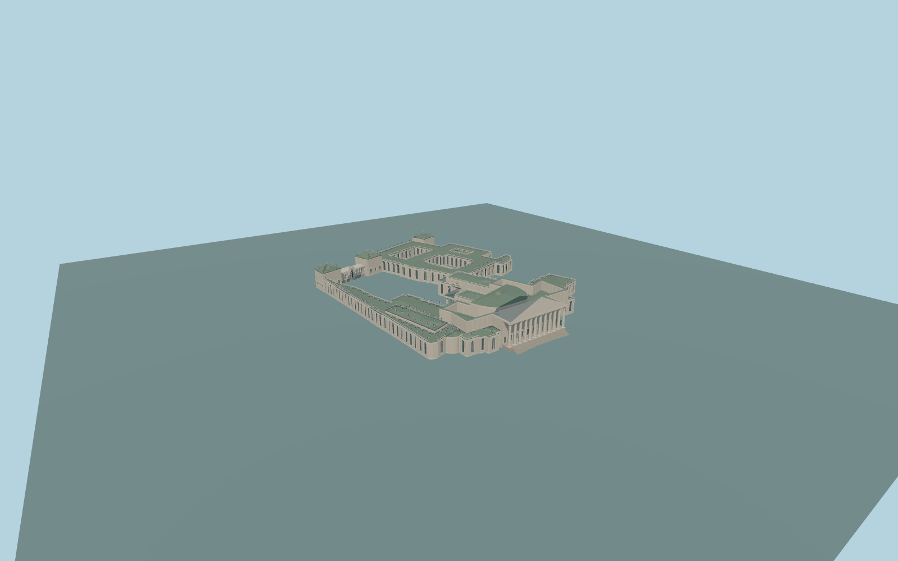

# Palais Bourbon

Complete connected Palais Bourbon parliamentary exterior: twelve-column river portico, tall solid blank/original pediment and broad stairs, rounded chamber roof, four-column ceremonial-court portico, both returned court wings, complete connected administrative/library ranges around all three actual courtyard holes, corner pavilions, mansard/dormer bands, open balustrades and closed recessed glazing/doors. Native north porch, court porch and south colonnade remain open between real columns. Separate Hôtel de Lassay frontage53, gallery52, ministries, city, gardens and artwork remain independent. No copied statuary, heraldry, lettering or interiors.

Rebuild: `node packages/worldgen/scripts/generate-palais-bourbon.mjs`;append `--check` for exact source bytes. Select import/LOD/placement with `--ids=palais_bourbon`. Detailed source and four browser tiers are separate ignored GLB outputs.

Complete connected Palais Bourbon parliamentary exterior: twelve-column river portico, tall solid blank/original pediment and broad stairs, rounded chamber roof, four-column ceremonial-court portico, both returned court wings, complete connected administrative/library ranges around all three actual courtyard holes, corner pavilions, mansard/dormer bands, open balustrades and closed recessed glazing/doors. Native north porch, court porch and south colonnade remain open between real columns. Separate Hôtel de Lassay frontage53, gallery52, ministries, city, gardens and artwork remain independent. No copied statuary, heraldry, lettering or interiors.

Approximate standard global DEM reference36m. Common palace floor38.6m; north portico platform40.6m and broad steps reach the unchanged native forecourt. Current native3D parts guide heights:27.4m pediment,22.7m rounded chamber roof,18.4m court hall and14.8m administrative roofs relative to datum36m. These are map/picture-guided approximate heights, not surveyed historic thresholds. Rear grades vary; actual native contact is checked in current renders. Broad stairs follow17 actual native-field samples across their width; skyline/district use5 and street/close-up9 of those samples. The deep court porch is carved out of the parent shell and has an original supported platform/closed backdrop.

Original medium-fi interpretation of capitals, dentils and blank/original pediments; carved art and lettering are excluded. Rear window/dormer inventories, roof seams and historic grades are approximate. All three native court holes stay roof-free; own low court-terrace ranges remain where mapped. Exact LOD errors and physical laptop/phone timings are unmeasured.

Six existing shared256px limestone,granite,slate,copper,painted-wood andwindow-grid graphs; seven material slots. Metric UVs/linear colors; no private or embedded images. Four authored browser tiers preserve the complete individual occupied plan and three actual court holes,12-column north portico,4-column court entry androunded chamber roof. District proxies,street real recesses,close-up capitals/dentils/dormers/open balustrades,andfine source flutes/mullions. Physical timings and numerical LOD errors remain unmeasured.

Original geometry:repository license. Map:© OpenStreetMap contributors,ODbL-1.0;Protomaps. Standard terrain:terrain-grid.json. Ordinary pictures stay local and are not redistributed or used as textures. Current acceptance:qa.json.
