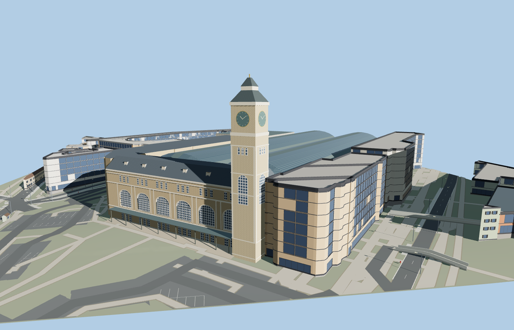

# Paris Gare de Lyon

Paris Gare de Lyon with its six arched Place Louis-Armand windows, mansard roof, southwest clock tower, twin vaulted steel train sheds, native track approaches and the adjoining north and east ranges.

The 43,820-triangle source rebuilds byte for byte. Skyline, district, street and close-up use 728, 3,720, 15,606, 39,116 triangles. The first two tiers total 355,176 bytes. Six GLBs validated and 38 current views were inspected.

The clock tower measures 67 m above its modeled base. The geographic viewer probe preserved 54 rail parts and 55 neighboring buildings. 11 mapped track centerlines cleared the southeast portals with at least 27.16 m to the roof at the sampled points. The close-up model passed 48 shed-post and 17 platform-grade probes. Failed loading restores the mapped building shell.

Façade ornament, clock details and annex elevations are simplified from exterior photographs. The shed glazing uses a patterned opaque shared material. Platforms follow the mapped plan and coarse Terrarium grade. This exterior visualization omits underground areas, operating systems, interior concourses and annexes beyond the modeled footprints. Physical-device timings are unmeasured.

Rebuild with `node packages/worldgen/scripts/generate-paris-gare-de-lyon.mjs`. Append `--check` to compare exact bytes. Use `--ids=paris_gare_de_lyon` for targeted import, LOD, placement and readiness.
