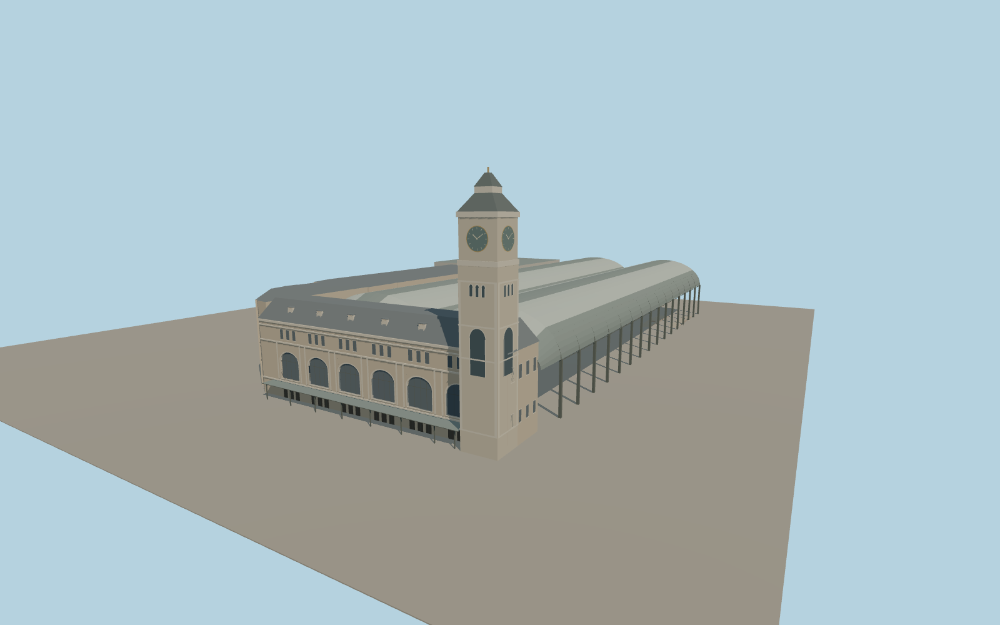

# Paris Gare de Lyon

Paris Gare de Lyon with its six arched Place Louis-Armand windows, mansard roof, southwest clock tower, twin vaulted steel train sheds, native track approaches and the adjoining north and east ranges.

Run `node packages/worldgen/scripts/generate-paris-gare-de-lyon.mjs` to rebuild the source master. Append `--check` to compare the exact bytes. Use `--ids=paris_gare_de_lyon` for targeted import, LOD generation and placement.

Façade ornament, clock details and annex elevations are simplified from exterior photographs. The shed glazing uses a patterned opaque shared material.

Platforms follow the mapped plan and coarse Terrarium grade. This exterior visualization omits underground areas, operating systems, interior concourses and annexes beyond the modeled footprints.

Original geometry follows the repository license. Map data is © OpenStreetMap contributors under ODbL-1.0 via Protomaps. Terrain samples are described in terrain-grid.json. Ordinary pictures stay local and are not redistributed or used as textures. Current acceptance:qa.json.
