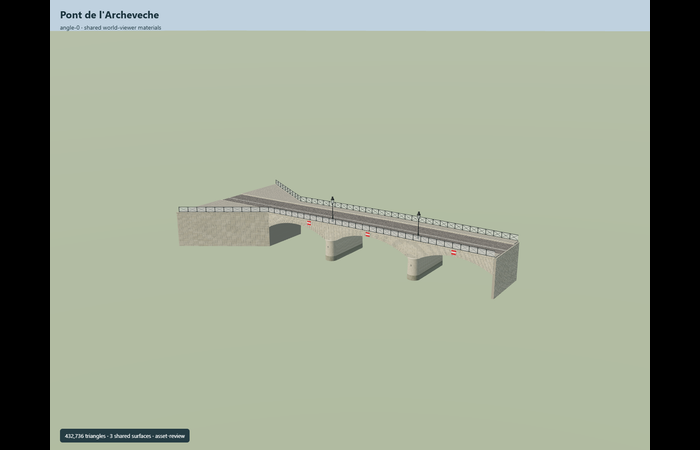
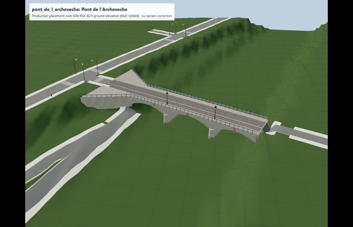

# Pont de l’Archevêché

Reviewed2026-10-29. Complete static medium-fi bridge exterior; existing host-datum placement contract retained.

Inspected74 current frames:13 portable,12 shared-material stage,29 medium-fi/context/tier frames and20 cached-terrain/road views. The original432736triangle master remains exact. All tiers retain three shallow open circular vaults,rounded projecting cutwaters,continuous crowned road,both raised sidewalks and wide asymmetric mainland flare. Close/street retain crossed transparent rail frames,modeled arch rings/soffit divisions,mooring rings and both mapped ornamental lamps. Detailed master retains individual coursing,fan sett courses,glazing hardware and direction-specific signs; browser tiers aggregate these details,including the small blue reverse navigation panel.

Three existing shared256px graphs: raw limestone,painted metal and granite paving. Local transparent glazing and navigation/stripe colors; no embedded/private images. Browser tiers use shared granite grain and broad staggered sett variation instead of thousands of separate fan-course blocks. Master geometry/materials are unchanged; each shared graph resolves once and resource unload passes.

| Level | Triangles | Bytes | Draws |
| --- | ---: | ---: | ---: |
| skyline | 632 | 51012 | 1 |
| district | 2772 | 229480 | 5 |
| street | 12988 | 1083492 | 5 |
| closeup | 29294 | 2449996 | 5 |

Master 432736triangles/36496176bytes retained exactly. Browser triangles 632 / 2772 / 12988 / 29294,bytes 51012 / 229480 / 1083492 / 2449996,draws 1 / 5 / 5 / 5. Initial skyline+district 280492bytes. All tiers meet1000/4000/16000/64000triangles,at most5draws,separate GPU position/normal streams. Physical laptop/phone timing remains unmeasured.

Retained exact-QID way78329745,anchor[2.351548575,48.851511875],heading1.164505939862457. +X north-northeast toward Île de la Cité,+Z east-southeast/upstream; southern abutment flare stays at negativeX. Production placement and26.96m NGF-IGN69 origin are unchanged. This existing host-datum contract requires compatible heights or an explicit conversion; generic global Mapzen datum equivalence is not claimed.

Fresh master/all-four-tier views reuse the exact cached terrain samples and18 retained independent mapped road context IDs without new downloads or terrain fitting. The lower quay road remains beneath the flared mainland end; source/model bounds,deck surface and grade remain aligned across tiers. Near-island X33m lies on the smoothed quay face,with a retained~2.62m ray gap; the upper road plateau at X40–44m remains the separate original fit evidence. Mainland residual~0.4m remains. These existing host-terrain limitations are carried forward,not erased by the tier refresh. All model geometry unloads. This scoped cached-terrain fixture does not claim a new current global PMTiles/water/building-preservation measurement.

## Limits

- Current permanent bridge geometry; temporary street works and movable furnishings are omitted.
- Arch ring thickness, coursing and lantern member dimensions are original photo reconstruction, not a scan.
- The declared NGF-IGN69 origin and bank joins use independent IGN terrain and road evidence. Submerged foundation depth remains reconstructed; water elevation is not bathymetry.
- The separate public clock and island streetlight stand beyond this model footprint and are not duplicated within it.
- Original detailed master is preserved. Browser tiers aggregate individual coursing/fan paving,transparent fasteners,lantern profiles and navigation signs; shared granite grain approximates small cobbles. Ground placement retains its existing NGF-IGN69 host-datum requirement. No new bespoke terrain research or device timing claim.
- Current source recipe index adds already-inspected local modules to the input binding. .artifacts/model-handoff/recipe-index-rebind.json proves unchanged source/runtime/image bytes for that metadata-only transition. Existing absolute datum and terrain fit limits remain; no new survey,engineering or device performance claim.
