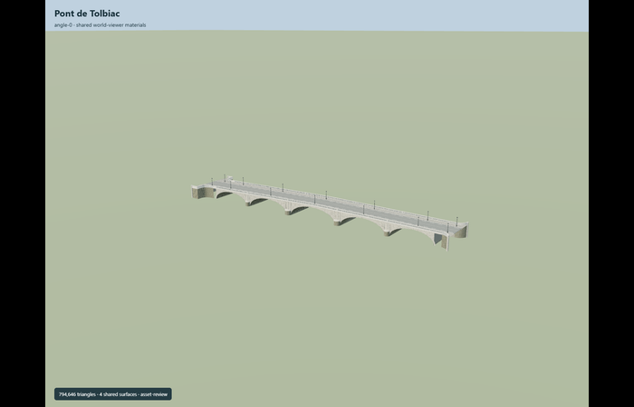
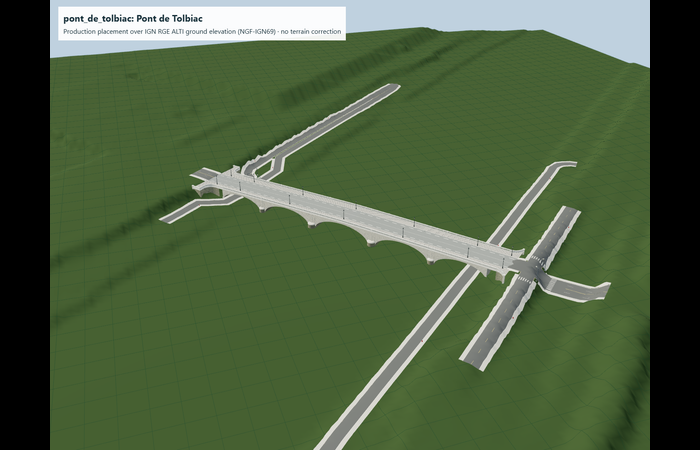

# Pont de Tolbiac

Reviewed2026-10-29. Complete static medium-fi bridge exterior; existing host-datum placement contract retained.

Inspected95 current frames:20 portable,19 shared-material master stage,36 medium-fi/context/tier frames and20 cached-terrain/road views. The original794646triangle master remains exact. All tiers retain five unequal open vaults,projecting round cutwaters,a continuous crowned road,both raised sidewalks and asymmetric curved bank wings. Close-up retains true rounded capsule balustrade apertures,pilasters,radial arch stones,dentils,all14 ornamental lamps and plaque backing. Street/district aggregate holes,dentils and lamps; skyline retains the five-vault/wing silhouette and parapet caps. The detailed master retains coursed soffits,ashlar,inscriptions,Gentilis lettering,memorial badge,fasteners,drains and grilles; their subpixel detail is deliberately aggregated in browser tiers.

Preserved master uses existing raw/weathered limestone,painted-metal and bronze graphs with local road/glass/marking materials. Browser levels use four existing256px graphs: raw limestone,weathered limestone,painted metal and concrete,plus local glazing and markings. Concrete grain approximates road/sidewalk paving. Metric UVs,component vertex colors,no embedded/private images. Shared graphs resolve once in the inspected asset fixture and model resources unload. No new material graphs or photo textures.

| Level | Triangles | Bytes | Draws |
| --- | ---: | ---: | ---: |
| skyline | 968 | 84712 | 1 |
| district | 3996 | 342960 | 6 |
| street | 15700 | 1287364 | 6 |
| closeup | 63996 | 5044244 | 6 |

Master 794646triangles/70414972bytes retained exactly. Browser triangles 968 / 3996 / 15700 / 63996,bytes 84712 / 342960 / 1287364 / 5044244,draws 1 / 6 / 6 / 6. Initial skyline+district 427672bytes. All tiers meet1000/4000/16000/64000triangles,at most6draws,separate GPU position/normal streams. Physical laptop/phone timing remains unmeasured.

Retained exact-QID way183626421,anchor[2.381000162446853,48.83290412880705],heading0.695619343418. +X northeast toward Bercy,+Z southeast/upstream. Production placement and27.4m NGF-IGN69 origin are unchanged. Five retained clear spans29/32/35/32/29m and map-fitted piers form a172.6m vault chain,distinct from the published168m nominal length. Approximate200.17m overall wing extents and all reconstructed details retain their existing source limits. Compatible host heights or explicit datum conversion remain required; global Mapzen equivalence is not claimed.

Fresh master/all-four-tier views reuse exact cached terrain samples and15 retained independent mapped road context IDs,with no new downloads or terrain fitting. Curved bank wings and model-covered road replacement remain at the original signed footprint. The lower quay roads remain beneath the outer arches. Native road endpoint rays retain~0.62m and~0.41m residuals across abrupt3m-grid bank edges; tier differences stay within2cm. Existing independent upper-road plateau samples35.4/35.6m remain separate from these edge-ray observations. The model normal-water reference28.50m and cached RGE water28.05m represent different states; no invented conversion or bathymetry. All model geometry unloads. This scoped cached-terrain fixture does not claim a fresh current global PMTiles/water/building-preservation measurement.

## Limits

- Nominal168m length conflicts with the mapped pier spacing and published clear spans; retain both rather than hiding the discrepancy.
- Quay stairways outside the recorded bridge footprint are not part of this asset. Exact current street-sign positions and memorial panel dimensions are reconstructed from photographs, not surveyed.
- Current terrain-fit captures must approve the IGN-supported vertical placement; river surface height varies.
- Detailed source/master are retained exactly. Browser close-up retains capsule openings and plaque backing but aggregates the memorial inscriptions,Gentilis glyphs,tiny fasteners,drain grilles and small carved details into their source masters. Street/district tiers merge repeated holes and dentils; skyline preserves the five-vault/cutwater/curved-wing silhouette with aggregated parapet caps.
- Runtime tiers reuse existing limestone,weathered limestone,painted-metal and concrete graphs. Shared concrete grain approximates roadway/sidewalk paving. Original master material assignments remain unchanged. Physical laptop/phone timing and a new global PMTiles datum comparison remain unmeasured.
- Original detailed master and production placement stay exact. New source-local distance recipe and manifest are registered before current captures. Existing datum/terrain limits remain; no new survey,engineering or device performance claim.
