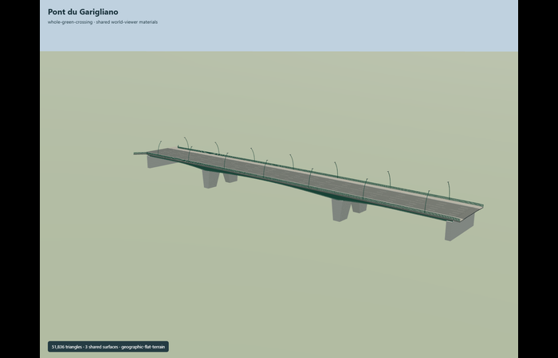
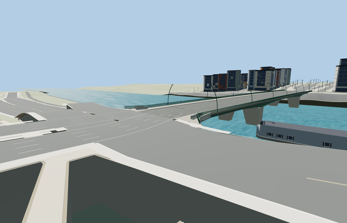

# Pont du Garigliano

Reviewed 2026-10-27. **Complete scoped static exterior and approximate native placement.**

Inspected 61 current frames: 11 portable, 11 shared-material/geographic-flat-terrain, 23 medium-fi and 16 actual native views. Full scoped crossing is present: three green haunched spans, six longitudinal girders, cross ribs/braces, two paired tapered stone-clad piers with open trapezoid portals, broad raised walks, six-lane road, vertical railings and curved lamps. Added short flared landing meshes and native road crown/walk tapers in the same pass. Dedicated piers/haunch/railing/road/underside and both unobstructed landing views supplement small distant turntables. The source preserves the detailed body while the far landing rails drop below pixel scale.

Three existing shared 256px `stone_limestone_raw`, `concrete_plain` and `metal_painted` graphs, metric UVs and linear vertex tints. Three near semantic groups, one far tinted group; no private/embedded images. The raw limestone graph keeps large modeled cladding joints clear. Each shared graph loads once and all model/support geometry disposes.

| Level | Triangles | Bytes | Draws |
| --- | ---: | ---: | ---: |
| skyline | 992 | 79128 | 1 |
| district | 3760 | 308548 | 3 |
| street | 15124 | 1228768 | 3 |
| closeup | 37900 | 3282024 | 3 |

Source 51836 triangles / 6152840 bytes. Runtime triangles 992 / 3760 / 15124 / 37900, bytes 79128 / 308548 / 1228768 / 3282024, draws 1 / 3 / 3 / 3. Initial skyline plus district 387676 bytes. Actual triangle/download budgets and separate GPU streams pass. Physical laptop/phone timings remain unmeasured.

Exact-QID way 374027143/Q2426843 establishes the footprint; street relation 11836164 and current named PMTiles road 35184388972507 establish the traffic frame. Anchor [2.268379032611847,48.83932476764754], heading 2.5366514902219626: +X northwest/Exelmans/Auteuil, -X southeast/General-Martial-Valin/Javel, +Z northeast/upstream/Pont Mirabeau. The 205.947441m traffic extent remains separate from 209m catalog length. Width 26m, pier stations, sections and absolute deck/water levels are photo/map reconstruction controls.

The southeast bridge junction was an existing interior vertex of a longer street loop. The runtime now splits that explicit same-kind/same-layer node to carry the authored grade, preserving original input vertices. Known road endpoints and bank hints also respect kind/layer. Short source landings extend 6.2m southeast and 3.3m northwest with flared walks and a small northwest road crown. At all four LODs, 21 actual outer-boundary samples (9 street and 12 path) retain native paving and model support with worst difference 0.022372928m. Six body-end lane samples meet within 0.0122m. These are approximate visualization joins, not surveyed elevations, engineering or vehicle-navigation certification.

All 66 resident buildings, 156 independent road centerline records, raw road inputs, DEM, displayed ground and five water features remain. The loaded output still has 167 road records: one fully replaced named crossing is removed and its connected street loop splits into two graded branches; connected bridge/path pieces are clipped/graded. Failed loading retains all 167 inputs and creates no support geometry. Unload releases every model/support geometry and preserves ground/water. No ground or building cutout. Native coarse banks, raised approach paving/automatic retaining faces, generic roads and unmeasured water stage remain reconstruction limits.

## Reconstruction limits

- Original photo-led full static exterior. Exact-QID footprint and named PMTiles traffic line establish the geographic frame; mapped road extent205.947441m is retained separately from catalog length209m. Approximate span arrangement58/93/58m, sections and heights are reconstruction controls, not surveyed engineering dimensions.
- Piers, girder haunch, stone-cladding grid, railing spacing and lamp sections are interpreted from three inspected ordinary photographs. The 18m catalog height does not establish a surveyed deck or water datum.
- Selected green appearance and road/sidewalk layout use the2006 side elevation and2016 sidewalk/underside photographs. This is a static exterior reconstruction; temporary signs, vehicles, boats, quays, station and independent street furniture are separate context.
- Native placement must be inspected against the standard PMTiles/Mapzen fixture before activation. No arbitrary neighboring terrain alteration or distorted bridge is approved by source generation.
- Short visualization landings extend6.2m southeast and3.3m northwest to the standard mapped paving. The northwest road crown and terminal walk tapers meet the viewer surfaces; they are approximate reconstruction controls, not surveyed bridge engineering or vehicle navigation grades.
- Independent Le Telephone artwork, neighboring quays, boats, tram/RER station, approach junction street furniture and buildings are not part of this bridge exterior asset. No photo pixels or downloaded model are used. Physical-device timings are unmeasured.
- Native standard terrain smooths banks and can sit below deliberately graded approach paving. Automatic retaining faces and approximate footing/bank embedding remain visible. Independent quays, buildings, station, artwork and street infrastructure are separate map context; no unique models for them are approved here.
