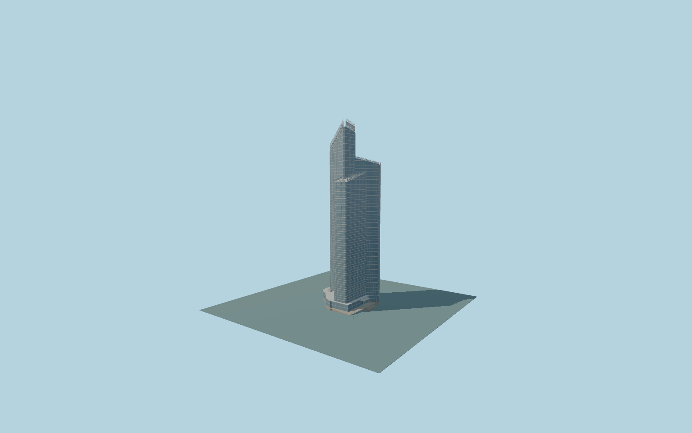

# Tour First

Complete modern Tour First:three joined blue-glazed wings with different heights/sloping pale roofs,rounded mapped corners,pale horizontal floor bands,open comb/lattice crest with folded triangular facets,louvers androof seams above thewhole low parent/east entry canopy,physical vestibule andnative-sampled stairs/posts.

Original source:models/tour-first-model.mjs,layout.json andattributed standard map/global-terrain controls. Rebuild with `node packages/worldgen/scripts/generate-tour-first.mjs`;append `--check` for exact bytes. Import/LOD commands select `--ids=tour_first`. GLBs are ignored outputs.

Four existing shared256px graphs;no private or embedded images. Detailed master andfour browser tiers remain separate. Retained Q1509747 parent andthree native wing polygons sign placement. Retained231m total controls open high crest;whole225m parent and240–250m thin fin tags are inconsistent andnot extruded literally. Current modern glazed tower,three sloping pale roofs andopen comb crown differ from the excluded historical AXA facade. Public plaza pool,independent towers andcontext bridges excluded. Roof/facade/crown/entry inventories and42m global-terrain datum remain approximate,not surveyed. See model-brief.json andqa.json for scope/current review.

Original geometry uses repository license. Maps:© OpenStreetMap contributors,ODbL-1.0;Protomaps. Terrain hashes/attribution:terrain-grid.json. Linked ordinary pictures are not redistributed or used as textures.
