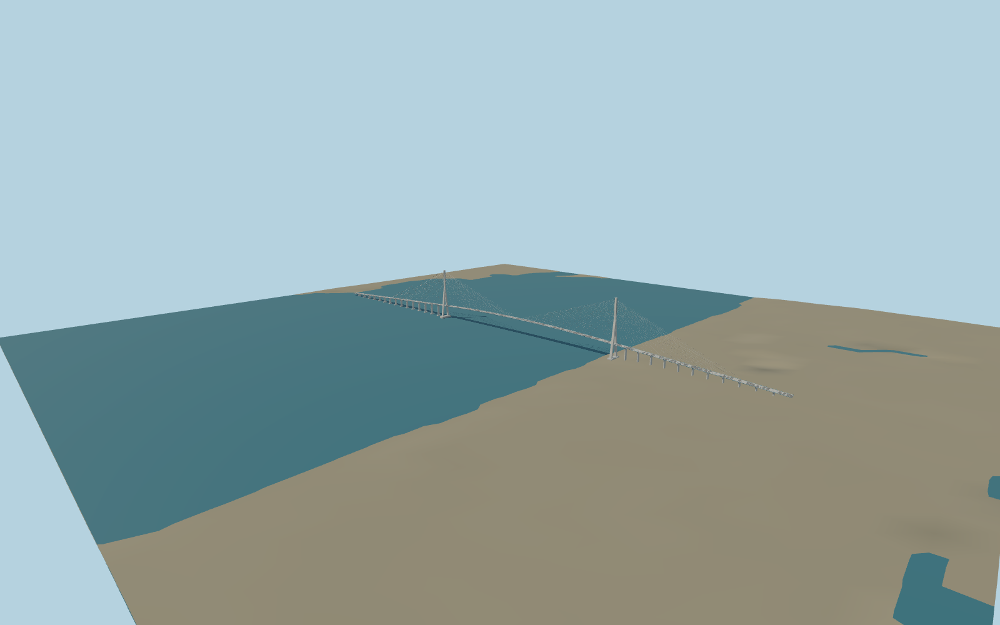

# Pont de Normandie — N0002

Picture and standard PMTiles exterior/placement review. Original detailed buildNormandie geometry remains unchanged and reproducible; reviewed shared-texture wrapper applies the explicit approximate datum shift and bounded water-contact bases.

Source geometry: `packages/worldgen/scripts/normandie-browser-model.mjs`. The original draft builder remains unchanged in `generate-next-1000-models.mjs`; its exact historical bytes are tested independently. All current models and four browser levels are rebuilt from checked-in recipes. No copied survey mesh, private image or embedded texture.

Shared surfaces: matgraph:molen.worldgen.material.concrete_plain, matgraph:molen.worldgen.material.metal_painted, matgraph:molen.worldgen.material.concrete_plain, matgraph:molen.worldgen.material.stone_limestone_weathered. Signed placement, references and accepted limits live in `map-frame.json`, `reference-metadata.json`, `review-scope.json` and [QA review](QA-REVIEW.md).

Rebuild only this item with `node packages/worldgen/scripts/generate-next-1000-models.mjs --ids=N0002`; import using the same ID and regenerate its browser levels. GLBs are build outputs.
