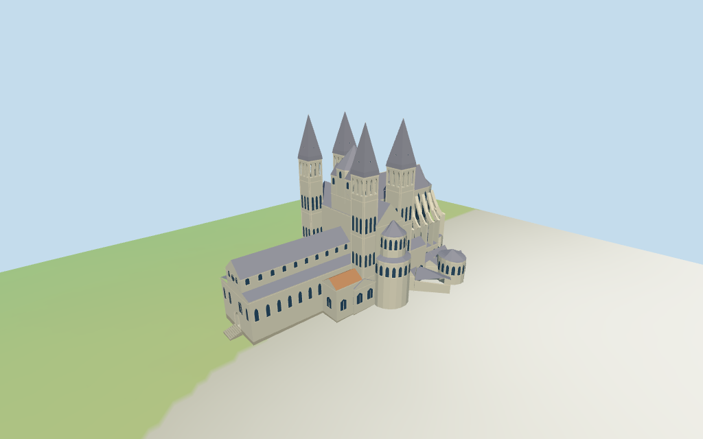

# Tournai Cathedral

Individual Tournai cathedral exterior with four taller open-belfry towers and lower central lantern, pointed slate roofs, stepped rounded transepts, lower western Romanesque nave, taller Gothic choir/apse/flying buttresses, selected chapels/annexes and estimated closed west portal.

## Evidence and reconstruction

Published dimensions and reconstructed details are separated in spec.json. Primary references:

- [Reference](https://visitwallonia.com/en-gb/content/notre-dame-de-tournai-cathedral-listed-unesco)
- [Reference](https://fasac.fr/cathedrales/tournai/)

Five existing shared256-square graphs supply limestone walls/trim, slate, chapel tile, raw stone foundations and wood doors. Linear tints and metric UVs; glazing uses vertex colors, no unique embedded image.

## Model and axes

26,570 triangles; 79,710 vertices; 7 material groups; 3,192,620 bytes. Native bounds: -68.290, -2.570, -34.797 to 66.781, 84.500, 43.575. Source hash: `sha256:fc5ecc6116c84f443865087b9f093dd5e248e1d18b9c867d1221d65d1e314d9f`.

{"x":"east along nave toward Gothic choir","y":"up","z":"south toward rounded transept"}

Two inspected elevated photographs and standard viewer PMTiles/DEM guide this individual cathedral exterior. Exact west portal design, sculpture/tracery, interiors and ground joins remain approximate. ©OpenStreetMap contributors,ODbL-1.0.

## Reproduce

Run `node packages/worldgen/scripts/generate-additional-landmarks.mjs --ids=tournai_cathedral` (or add `--check`). The generator preserves manually edited masters by checking their baseline hashes. Import through the standard authored-model workflow with optimization disabled; then capture all QA cameras, including shared-surface views.

## Pending work

- Current main/55 component footprints and nominal heights are retained; eave/spire splits, semicircular roof profiles, flying buttresses, window rhythm, untagged ancillary12m heights and all ornament are picture-led estimates. Derived roof masks are rounded to0.01mm for clipping; source footprint controls remain unchanged.
- NativeY0 follows standardDEM27.636844m. Estimated1.5m common floor against perimeter−2.22..3.25m produces approximate foundation skirts and some terrain embedding. Precise plaza/doorstep levels, surveyed placement and walking/collision certification are unverified.
- Skyline preserves the five pointed towers, rounded transepts, lower nave and taller choir. District restores shared materials and principal belfry cuts; street/closeup add triple open belfry galleries, facade rhythms and flying buttresses. Surface windows and closed entrance doors do not reconstruct full interiors.
- Exact west-facade design, sculptural portals, tracery, statues, inscriptions, interior plans and separate city belfry are excluded. Neighbors are synthetic terraced context. Physical laptop/phone measurements remain pending.

This bundle follows the medium-fi standard. Medium-fi appearance and geographic fit are reviewed separately. Hash-bound visual acceptance is recorded separately after capture inspection.

## Additional geographic data

©OpenStreetMap contributors; Protomaps; Mapzen/USGS terrain tiles.
