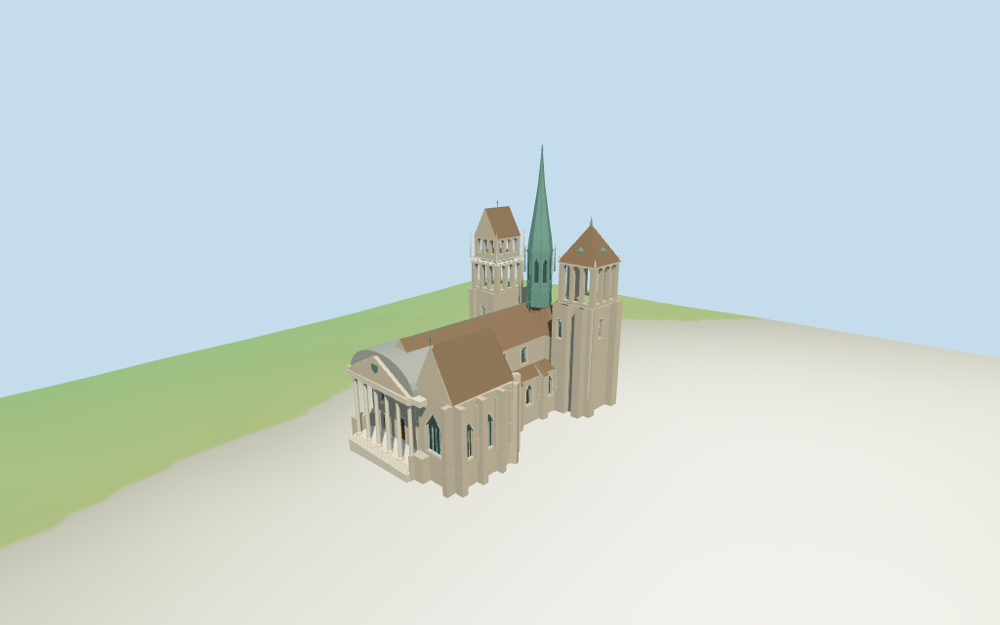

# St. Pierre Cathedral

Individual St. Pierre Cathedral, Geneva: six free-standing Corinthian-like columns/open portico, inset wood portals and triangular pediment/rounded gray metal vault; adjoining tall Gothic Maccabees chapel with pointed glazing, buttresses and steep brown roof. Long brown-roofed nave/aisles, rounded east apse, unequal pale open belfry towers, south hipped cap versus north two-tier arcade/steep roof/pinnacles, and tall green octagonal panelled/ribbed central spire. Five existing shared stone/continuous limestone/flat tile/copper/wood graphs, metric UVs, linear tints and four browser levels. Fine carved heraldry/statues/tracery, exact weather vanes, interiors and surveyed paving remain approximate or excluded.

## Evidence and reconstruction

Published dimensions and reconstructed details are separated in spec.json. Primary references:

- [Reference](https://commons.wikimedia.org/wiki/File:Gen%C3%A8ve_Cath%C3%A9drale_St._Pierre_Fassade.JPG)
- [Reference](https://commons.wikimedia.org/wiki/File:St_Pierre_Cathedral_-_Geneva,_Switzerland_-_panoramio.jpg)
- [Reference](https://commons.wikimedia.org/wiki/File:Parte_absidale_della_Cattedrale_di_San_Pietro_a_Ginevra.jpg)
- [Reference](https://commons.wikimedia.org/wiki/File:Cathedral_of_Geneva.jpg)

Five existing cached256-square coursed limestone,continuous limestone,flat tile,copper and plain-wood graphs serve seven merged groups. Linear stone/brown/green/wood tints,metric UVs,flat architectural normals; glass/ironwork use geometric PBR colors. No embedded images,unique facade maps or baked shadows.

## Model and axes

19,340 triangles; 58,020 vertices; 7 material groups; 2,324,904 bytes. Native bounds: -37.550, -2.374, -22.147 to 36.803, 68.000, 22.218. Source hash: `sha256:dce559e249779a69ae402ed71bbdf2a975d000775489a20b6b94969214921658`.

{"x":"eastward from western portico toward rounded apse","y":"up","z":"southward toward Maccabees chapel/south tower"}

Standard viewer DEM datum 405.265282m; display floor2m, raw whole perimeter -2.02..1.58m. Footings extend below coarse terrain; estimated local front stairs approach a threshold0.5m above model floor. Exact hilltop paving/door joins, absolute altitude and walking remain unverified. No global flattening or road replacement.

## Reproduce

Run `node packages/worldgen/scripts/generate-additional-landmarks.mjs --ids=st_pierre_cathedral` (or add `--check`). The generator preserves manually edited masters by checking their baseline hashes. Import through the standard authored-model workflow with optimization disabled; then capture all QA cameras, including shared-surface views.

## Pending work

- Retained exact-QID OSM way397737238/Q666516 matches current main35184769826070 (113 vertices rather than earlier124). Main and ten component controls retain all312 current raw vertices/tags with rigid rotation and no rescale. Component labels are inferred from plan position and four inspected pictures, not individual QIDs. No current map height/min_height or measured height facts. Original multilingual identity and earlier control remain verbatim. Native-X western portico versus+X rounded apse signs facing. All vertical levels and internal partitions are picture estimates: nave17.8/25.5m, aisles10.5/13.2m, choir/apse17.8/25.5m, Maccabees17.8/28.5m; south tower open belfry28..38m, hipped cap47m/vane49m; north lower belfry26..34m and upper36..41m, steep roof49m/finials51m; green central octagonal shaft24..39m, taper64m/tip66m. Portico columns0.5..15.5m, entablature16.8m/triangular crown22.8m and rounded metal vault23.4m; column plane x-35.2m, entry wall-30.5m. Ground/body partitions omit the open portico air space through the whole front edge. Clean six-vertex chapel and eight-vertex apse roof contours are estimated inside the mapped buttress plans; stepped wall caps remain below the roof. Minor annex/service/stair partitions, windows/buttresses/finials and exact facade joins are approximate. No survey/engineering accuracy claimed.
- Standard viewer DEM datum 405.265282m; display floor2m, raw whole perimeter -2.02..1.58m. Footings extend below coarse terrain; estimated local front stairs approach a threshold0.5m above model floor. Exact hilltop paving/door joins, absolute altitude and walking remain unverified. No global flattening or road replacement.
- Medium-fi exterior from inspected2013 front,2014 southwest,2020 elevated and undated older rear-detail pictures plus standard viewer PMTiles/DEM only. Heights/vertical subdivisions,minor annex functions,roof/vault shapes and ornament are estimates. The older rear picture does not establish current finish; the elevated picture crops the central spire tip. Exact coats of arms,statue identity/fine tracery,roof decoration/vanes,full interiors and surveyed paving/thresholds remain approximate or excluded. Physical phone/laptop timings pending.
- Skyline retains pale six-column front/crown/rounded vault,tiled roofs,unequal towers and green shaft/tall spire; windows/small balustrades omitted. District adds shared surfaces,flat glazing/portal fields and actual open tower arcades. Street adds real recessed glazing/wood doors,sparse copper ribs/panels,buttresses,balustrade/pinnacles;closeup/master refine column capitals/tracery/dormers. Synthetic cottages are fixtures.

This bundle follows the medium-fi standard. Medium-fi appearance and geographic fit are reviewed separately. Hash-bound visual acceptance is recorded separately after capture inspection.

## Additional geographic data

©OpenStreetMap contributors; Protomaps; Mapzen/USGS terrain tiles.
