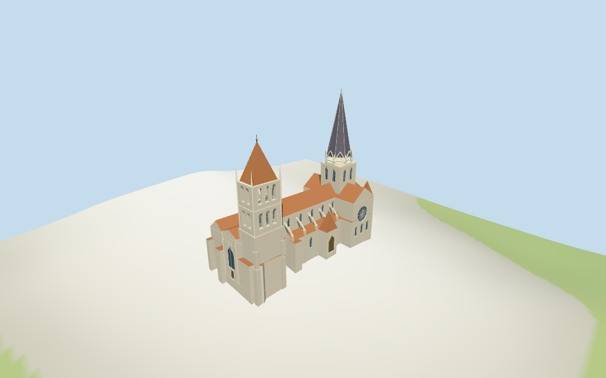

# Lausanne Cathedral

Individual Lausanne Cathedral medium-fi exterior: long tiled Gothic nave/flying buttresses, cruciform transept with southern rose and three lower lights, rounded choir/ambulatory and two small red pyramidal east towers; tall dark slate crossing spire with open gabled crown, shorter massive west beffroi with two open arcades/red cap/corner pinnacles; west Montfalcon portal and south painted porch; lower northwest range. Six shared graphs and four browser LODs. Sculpture/tracery simplified, all detailed profiles estimated.

## Evidence and reconstruction

Published dimensions and reconstructed details are separated in spec.json. Primary references:

- [Reference](https://commons.wikimedia.org/wiki/File:Lausanne-cathe7.JPG)
- [Reference](https://commons.wikimedia.org/wiki/File:Vue_a%C3%A9rienne_de_la_cath%C3%A9drale_de_Lausanne.jpg)
- [Reference](https://commons.wikimedia.org/wiki/File:Cath%C3%A9drale_de_Lausanne,_southern_side.jpg)
- [Reference](https://commons.wikimedia.org/wiki/File:West_side_of_Cath%C3%A9drale_de_Lausanne.jpg)
- [Reference](https://commons.wikimedia.org/wiki/File:Lausanne_Cath%C3%A9drale_Notre-Dame_01.jpg)

Six existing shared 256-square continuous limestone, sandstone, ceramic tile, slate, plain wood and painted metal graphs serve seven groups including local blue-grey glass. Linear tints, metric UVs, flat architectural normals; no embedded images, unique facade photographs, baked lighting or micro-carving.

## Model and axes

10,236 triangles; 30,708 vertices; 7 material groups; 1,232,540 bytes. Native bounds: -49.374, -5.649, -20.804 to 49.405, 80.100, 20.845. Source hash: `sha256:6d7e73c8cb680ddf6c24c5795a764f5cb6ea688deeedc176f43c20aa22044812`.

{"x":"east toward rounded choir","y":"up","z":"south toward rose and painted porch"}

Standard viewer DEM datum 532.855765 m; selected raw perimeter -5.17 to 0.35 m. Floor 0.5 m, adaptive footings cross Y=0 and extend below retained samples. No ground cutout or flattening. Exact hilltop terrace, west parvis, south steps, threshold/base joins, absolute altitude and walking remain unverified.

## Reproduce

Run `node packages/worldgen/scripts/generate-additional-landmarks.mjs --ids=lausanne_cathedral` (or add `--check`). The generator preserves manually edited masters by checking their baseline hashes. Import through the standard authored-model workflow with optimization disabled; then capture all QA cameras, including shared-surface views.

## Pending work

- Exact retained way/25718547 and Q669544 identify Cathédrale Notre-Dame de Lausanne, current standard viewer PMTiles whole 35184397807379 and same-ID POI. Preserve its 56 raw outline points/properties and earlier whole/tags. Anchor [6.635364655,46.522599639] and heading -0.121409763039 rad unchanged. Native +X faces the eastern rounded choir, -X the west Montfalcon entrance; +Z faces the south rose/painted porch and western beffroi. No horizontal rescale. The long nave, southern porch projection, western block and eastern transept/apse constrain estimated detailed plans. Neighboring episcopal/town buildings and streets remain host content.
- Retained Wikidata height 79.6 m has no component qualifier or reference URL; use it as an overall scale reference assigned to the tallest crossing-spire tip, consistent with inspected pictures, rather than a newly verified survey. No current mapped height/level tags. Above floor 0.5 m, other heights are picture estimates: high nave/transept 23.5 m eaves / 30.1 m ridge; high choir 22 / 28.4 m; low aisles/ambulatory 13.2 / 16.5 m; west narthex 22.5 / 25 m. Western beffroi solid shaft 26.5 m, two arcaded stages to 47.5 m, red cap 62.5 m, small metal finial 65.5 m. Crossing body 40.5 m, open gabled crown 48 m, slate spire to 78.3 m and tip 79.6 m. Two eastern squat towers 22.5 m walls / 31.5 m red roofs. Southern painted porch 13.2 m eave / 23 m roof. Lower northwest range 19 / 24 m. Every detailed division, opening/tracery, buttress, turret, spire profile and step is an estimate.
- Standard viewer DEM datum 532.855765 m; selected raw perimeter -5.17 to 0.35 m. Floor 0.5 m, adaptive footings cross Y=0 and extend below retained samples. No ground cutout or flattening. Exact hilltop terrace, west parvis, south steps, threshold/base joins, absolute altitude and walking remain unverified.
- Individual medium-fi exterior from five inspected photographs and standard viewer PMTiles/DEM. The unqualified retained 79.6 m height controls the overall tip scale; other heights and all detailed component plans are estimates. Fine rose/portal tracery, sculpture, inscriptions, interiors/bells, concealed roofs, current finish, engineering and exact terrace/step/base contact simplified, excluded or unverified. North-west lower range roof is a plan-constrained estimate because reference pictures crop it. Synthetic Swiss chalet neighbors are style fixtures. Physical phone/laptop timing pending.
- Skyline retains the long cruciform church, rounded choir, south rose marker/porch, massive west beffroi/red cap and high slate crossing spire/open crown. District adds shared surfaces, clerestory/choir recesses, coarse rose spokes, west portal bands, flying buttresses and two open bell stages. Street adds aisle/tower lights, more arches, mullions, finer rose ring, pinnacle and portal figure abstractions; close-up/master retain the same individual exterior detail.

This bundle follows the medium-fi standard. Medium-fi appearance and geographic fit are reviewed separately. Hash-bound visual acceptance is recorded separately after capture inspection.

## Additional geographic data

©OpenStreetMap contributors; Protomaps; Mapzen/USGS terrain tiles.
