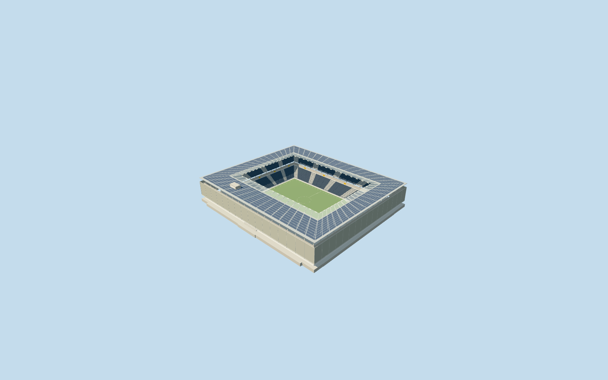
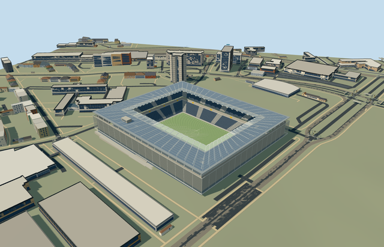

# stadion_wankdorf — Stadion Wankdorf

Reviewed2026-10-20 in one author/build/inspect/fix pass.

## Appearance

Inspected all48 final current source/shared/medium-fi/native views. Specific rectangular Wankdorf with integrated mapped base, flat solar canopy/translucent inner strip/closed wing underside/pale roof support frame, screened facade/recessed base glazing, two dark seating tiers/pale aisles/yellow access accents/projecting south hospitality belt, neutral field/goals/supported end displays/small rooftop cabin. Closed an exposed roof-wing edge and increased leading-strip alpha during the same author/inspect/fix pass. No copied seat lettering, advertisements, crowd or photo atlas.

## Shared surfaces and browser budgets

Six existing256px graphs: concrete_plain, metal_painted, metal_perforated_square, metal_standing_seam, fabric_canvas and window_grid. One image-free double-sided PBR translucent material with55percent alpha serves the leading strip. Shared mesh uses recessed backing; solar panels reuse tinted shared glazing. No new graph, embedded image or unique atlas. Seven near draws/one skyline draw; each graph read once; separate POSITION/NORMAL streams with equal CPU/GPU accounting. Surface transmission/reflection remains approximate.

| Level | Triangles | Bytes | Draws |
| --- | ---: | ---: | ---: |
| skyline | 318 | 27636 | 1 |
| district | 1808 | 162700 | 7 |
| street | 12664 | 1099824 | 7 |
| closeup | 55728 | 5117848 | 7 |

Four authored browser levels retain the native rectangular stadium/open field, broad solar wing, screened facade and two main banks/south projection. Fine rows, lattice, entry flights and thin framing appear near the camera. Levels318/1808/12664/55728triangles; initial skyline plus district190336bytes, below3MB phone/6MB laptop asset targets. Physical laptop/phone/tablet and dense-city performance measurements remain pending.

## Approximate native placement

Retained Q194479 and named native Stadion Wankdorf POI35184404574015 establish owned building52776562948269. Pitch35184420213294 supplies map-derived 110.92972798121477 by 74.1033718131827m field surround and axis. Own21-point outer controls integrated base, four-point approximately136x96m hole controls the open roof; lower116x78m bowl/runoff remains separate. Anchor[7.464870661497116,46.96311498116273]/heading0/native east-south/internal X[0.8854369248295099,0.46475956380526573]/Z[-0.46475956380526573,0.8854369248295099]. Integrated south projection follows the positive internal Z side; its fine facing and layout remain picture-led estimates. All neighboring native records remain independent. Production helper removes only owned stadium52776562948269. All408 independent resident inputs of409 originals/all799 wider independent inputs remain unchanged. Original6m grid, native roads and112.95618001685943square metres source water are retained. Three actual PMTiles13/14/15 cases pass; generalized merged complexes use bounded clipping. Failure retains409 originals; every level unload restores ground/water/zero live model geometry. Original standard6m Mapzen grid, roads, water and all independent buildings are retained. Datum556.6123752579924m defines field/modelY0. Boundary original samples span-2.870661703437804..2.5407756651422915m. Own retaining base extends below minimum grade; bounded ground opening remains inside that occupied base at every level. External supports meet individual sampled original grades. Only stadium parent52776562948269 is replaced with99.5percent whole-feature coverage; generalized lower levels use bounded area clipping. Failure/unload retains/restores original terrain/context.

## Limits

Four ordinary published photographs actually viewed: exposed outer frame, completed screened facade/entry stair, two-tier bowl/translucent roof edge/south projection and aerial solar layout. Modern2005 venue distinguished from demolished predecessor. Published2005–2013 reference appearance; exposure dates/current condition unverified. No qualified native architectural height. Working roof30.4m above original field datum, opaque wing underside27.1..30.15m, facade6..25m, lower seats1.5..11.2m/upper15.2..26m and raised southern upper bank22.3..26m over projecting hospitality belt11.2..22m are photograph-led allocations. Service cabin31..34.7m, rows/framing/solar partitions/aisles/entry flights are approximate. The inner translucent strip is approximately eight metres wide; image-free55percent-alpha PBR approximates its transmission. Published2005–2013 material defines an historical completed reference, not present condition. No precise survey, engineering, access, optical or working solar/electrical certification. Original standard6m Mapzen grid, roads, water and all independent buildings are retained. Datum556.6123752579924m defines field/modelY0. Boundary original samples span-2.870661703437804..2.5407756651422915m. Own retaining base extends below minimum grade; bounded ground opening remains inside that occupied base at every level. External supports meet individual sampled original grades. Only stadium parent52776562948269 is replaced with99.5percent whole-feature coverage; generalized lower levels use bounded area clipping. Failure/unload retains/restores original terrain/context.

## Selected checks

Six Khronos files: zero errors/warnings.5951 actual geometry/material/contact checks,48 current inspected views,three actual native map-level cases. Selected source/import/placement/strict medium-fi/scene validation pass. Sim30 hash0980bbc400a9d7b7f9027c99faaa6cc9efc0692a5775da477ab93b11e095b766.

Source sha256:896619483447c6916ca503b49956f2f4e57aa5e8a214b907f639eafd3b77ca30

Runtime sha256:14321a10ff7acf3139a3082626580e337d220684e2573d88628914bdf7051109

Input sha256:3dc03b85518e05911e353df212bc56ff133743f0c14af9a58be17d0df110285f

Rebuild: node packages/worldgen/scripts/generate-additional-landmarks.mjs --ids=stadion_wankdorf; node packages/worldgen/scripts/import-structure-models.mjs --ids=stadion_wankdorf; node packages/tooling/scripts/generate-landmark-lods.mjs --ids=stadion_wankdorf --force.

## Ordinary picture references

https://www.nextroom.at/building.php?id=19365 — https://www.nextroom.at/data/media/med_media/large/1138447482.jpg?1484922014; Philipp Zinniker; Copyright retained; viewed only, no copied pixels. Viewed only/no copied pixels.

https://www.nextroom.at/building.php?id=19365 — https://www.nextroom.at/data/media/med_media/large/1138447586.jpg?1484922014; Philipp Zinniker; Copyright retained; viewed only, no copied pixels. Viewed only/no copied pixels.

https://www.nextroom.at/building.php?id=19365 — https://www.nextroom.at/data/media/med_media/large/101_19087_sds%20683-10.jpg?1448891240; Hans Ege; Copyright retained; viewed only, no copied pixels. Viewed only/no copied pixels.

https://www.bipv.ch/www.bipv.ch/index.php/de/sportanlage/item/563-stade-de-suisse.html — https://www.bipv.ch/images/esempi/sportivo/stade_de_suisse/Stade-de-Suisse_sb1.jpg; Lüscher Architects credited by SUPSI/ISAAC; individual photographer unverified; Copyright retained; viewed only, no copied pixels. Viewed only/no copied pixels.
