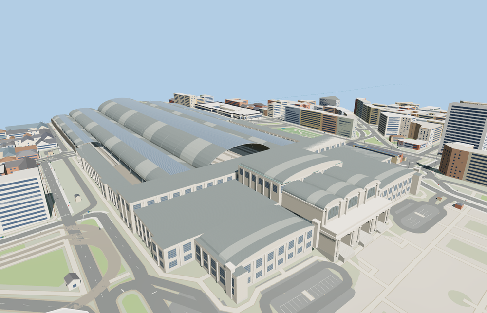

# Milano Centrale railway station

Milano Centrale faces Piazza Duca d’Aosta with a pale limestone portico, three open entrance bays and a taller barrel-roofed concourse. Five glazed train sheds shelter 24 mapped track positions and a raised deck of boarding platforms.

The 124,307-triangle source rebuilds byte for byte. Skyline, district, street and close-up use 992, 3,907, 14,817, 63,611 triangles. Skyline and district total 368,584 bytes. Six GLBs validated and 36 current views were inspected.

All four tiers pass the roof, platform, track, apron and recessed entrance probes. The viewer retains 548 independent building records and 1040 transportation records. Failed loading restores all 27 mapped station parts and the native ground.

The station relation supplies the principal walls and shed footprints. PMTiles stop positions, platform edges, and rail centerlines control the raised platforms and tracks. The deck grade, canopy profiles, façade carving and public hall arrangement are exterior-photo reconstructions. The track apron tapers into the standard terrain beyond the covered sheds. Underground passages, signaling, and exact sculptural figures are outside this model.

Rebuild with `node packages/worldgen/scripts/generate-milano-centrale-station.mjs`. Append `--check` to compare exact bytes. Use `--ids=milano_centrale_railway_station` for targeted import, LOD, placement and readiness.
